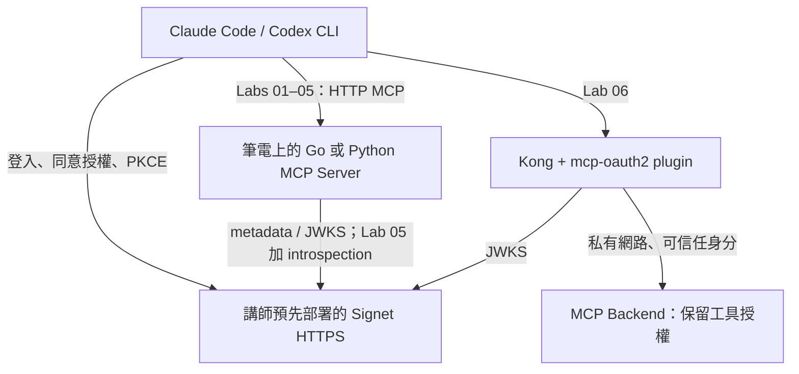

# MCP OAuth 2.0 Workshop

讓 AI Agent、MCP Server 與 CLI 安全登入的實作工作坊。

以 **[MCP Authorization 2025-11-25](https://modelcontextprotocol.io/specification/2025-11-25/basic/authorization)** 為教材基準，提供 **Go / Python 兩條完整範例路線**。學員選一種語言、一套 MCP Client（Claude Code 或 Codex CLI）操作即可。

- 活動：[Hello World Dev Conference 2026](https://hwdc.ithome.com.tw/2026/lab/4993)
- 場次：2026/10/14；13:00–13:30 環境準備，13:30–15:00 正式課程；活動頁另列 10/15 同內容場次。
- 容量：60 人。建議 3–4 位助教；環境安裝在課前完成。
- **授權服務由講師在課前建立全新的 [Signet](https://signet.wu-boy.com/)**，現場服務為 **https://signet.wu-boy.com**（issuer 不含結尾斜線）。學員不用安裝 Signet，也不用在前五關安裝 Kong。
- **Kong 只在最後一關登場**，比較 MCP Server 自己處理授權，與 Gateway 集中管理的差異。

> 範例、教材與本機協定測試已提供。現場 issuer 已設定；學員登入後建立自己的 Client App，講師補齊業務權限並核准。講師共用 public App 作為備援。真實 Signet、兩套 AI CLI 登入及 Kong 容器的彩排狀態見 [驗證紀錄](docs/validation.md)；不要將本機測試視為現場整合已完成。

## 課程路線

| Lab | 主題 | 驗收成果 | 時間 |
| --- | --- | --- | --- |
| [01](labs/01/README.md) | MCP 起手式與自己的 Client App | 呼叫未授權 MCP；登入 Signet、建立自己的 public App | 10 分 |
| [02](labs/02/README.md) | 授權探索 | 從 401 → Protected Resource Metadata → Signet metadata | 15 分 |
| [03](labs/03/README.md) | PKCE 登入與 Token 驗證 | 登入後成功呼叫；驗簽、issuer、audience、expiry 與 access type 均檢查 | 20 分 |
| [04](labs/04/README.md) | scope 與 resource 隔離 | 寫入權限不足被擋；A 的 Token 無法呼叫 B | 20 分 |
| [05](labs/05/README.md) | 撤銷與稽核 | 同一顆 Token 撤銷前成功、撤銷後失敗 | 10 分 |
| [06](labs/06/README.md) | Kong MCP Gateway | 共通入口授權移至 Kong，Server 保留工具權限 | 10 分 |

另留 5 分鐘 Q&A。入場先完成 Signet 登入；Lab 01 約 4 分鐘認識 MCP、6 分鐘建立 App，Lab 02 期間由講師處理核准，Lab 03 開始使用自己的 Client ID。若仍在等待則切換共用 App 備援。每關都可以獨立啟動，不必依賴前一關修改。只在 Lab 04 同時開 A/B 兩個 Server。

## 架構



OAuth Client、Authorization Server、Resource Server 各自有清楚責任。Client 自己完成 OAuth，Kong 不代替使用者登入。

## 開始前

1. 安裝 Git、curl、編輯器；選 **Go 1.26.7** 或 **Python 3.12 + uv**。Windows 使用 WSL2。
2. 安裝 Claude Code 或 Codex CLI，確認自己的 AI 帳號可使用。參考 OAuth Client 不需要模型 API key。
3. `.env.example` 已填入現場 issuer；先閱讀 [學員建立 Client App 教學](docs/signet-client-app.md)，用自己的帳號建立 public App，經講師核准後使用自己的 Client ID。Lab 05 另有每組獨立的 introspection Client 憑證。
4. Lab 06 使用 Docker Compose v2，由講師先準備映像；學員不用在課堂等待下載與編譯。

```bash
git clone https://github.com/go-training/mcp-oauth2-workshop.git
cd mcp-oauth2-workshop
cp .env.example .env
chmod 600 .env
# 編輯 .env：保留 SIGNET_ISSUER=https://signet.wu-boy.com，填入自己的已核准 Client ID；等待核准時可用講師備援 ID。
# 每個新終端都要載入；scripts 不自動覆寫你已設定的環境變數。
set -a
source .env
set +a
```

選擇路線，先下載依賴：

```bash
# Go
(cd go && go mod download)
./scripts/lab.sh 01 go

# 或 Python（在另一個操作時段執行，避免兩者占用同一 port）
uv sync --project python --frozen
./scripts/lab.sh 01 python
```

在另一個終端呼叫（從 repo 根目錄執行）：

```bash
./scripts/oauth.sh go call --token-file .tokens/anonymous.json
# Python 路線使用相同參數
./scripts/oauth.sh python call --token-file .tokens/anonymous.json
```

接著依 [Client 設定](docs/clients.md) 連上 Claude Code／Codex，再從 Lab 01 順序練習。換關時 Ctrl-C 停止舊 Server，再啟動下一關；記憶體中的筆記會清空。

## 程式碼怎麼讀

| 內容 | Go | Python |
| --- | --- | --- |
| 六個可執行 Lab | [go/labs](go/labs) | [python/labs](python/labs) |
| 完整 MCP 與授權實作 | [server.go](go/internal/workshop/server.go) | [server.py](python/workshop/server.py) |
| PKCE / MCP 呼叫 / 撤銷參考 Client | [oauth/main.go](go/cmd/oauth/main.go) | [oauth.py](python/workshop/oauth.py) |

入口程式選擇 Lab 階段，共用實作保留所有原始碼，避免複製十二份授權程式後發生修正不同步。教材會標出各關應閱讀的函式。這是完整可執行的完成版；練習在於修改設定、觀察請求與驗證拒絕情境，不要求現場手刻 OAuth 或 JWT。

三個工具：`whoami`、`list_notes`、`create_note`。筆記只存在記憶體，授權後依 subject 隔離，不使用真實公司資料。

## 安全邊界與取捨

- Lab 01 刻意沒有授權；Lab 02 刻意只回 discovery challenge，尚不接受 Token。它們是明確的教學中間狀態。
- Labs 03–05 使用 RS256 + JWKS；這是本教材的選擇，不是 MCP 強制要求 JWT。所有受保護關卡從一開始就驗證 audience；Lab 04 加深觀察，不先引入不安全的驗證版本。
- Signet access token 必須有 `type=access`，不能拿 refresh token 或 ID token 呼叫 MCP。
- Lab 05 本地 JWT 驗證後，每次請求額外查 introspection `active`，不快取成功狀態。服務不可用時拒絕放行並回 503。
- Lab 06 的 plugin 本身是離線 JWT 驗證，**不保留 Lab 05 的即時撤銷保證**。上線前須決定在哪一層提供撤銷檢查；不要把 Gateway 當成自動解決所有授權問題。
- `notes:read` 控制入口；`notes:write` 控制寫入工具。MCP Server 始終保留工具／資料的業務權限。
- 本機範例僅允許 loopback HTTP；遠端 issuer 使用 HTTPS。`ALLOW_INSECURE_ISSUER=1` 只供 loopback 測試 fixture，不能用來跳過遠端 TLS。
- Token 檔案使用 0600 並被 Git 忽略；不要把完整 Token 放進聊天、投影片或截圖。

## 教材與驗證

- [學員：登入 Signet、建立自己的 Client App](docs/signet-client-app.md)
- [Claude Code / Codex CLI](docs/clients.md)
- [講師：Signet 與現場準備](docs/instructor.md)
- [故障排除](docs/troubleshooting.md)
- [驗證紀錄與待彩排項目](docs/validation.md)
- [實作計畫](plan.md)

```bash
./scripts/check.sh
```

測試會啟動 Go / Python 的六個 Lab，以及明確標示的本機測試 issuer；不使用現場帳密。涵蓋協定呼叫、PKCE、錯誤 Token、scope、audience、使用者隔離、撤銷與 Gateway 信任邊界。

Device Flow 保留為後續延伸主題，不列入這六關主線；若活動頁仍承諾現場操作，講師需同步調整課程說明。

## 參考

- [MCP Authorization 2025-11-25](https://modelcontextprotocol.io/specification/2025-11-25/basic/authorization)
- [Signet](https://signet.wu-boy.com/)
- [Kong MCP OAuth2 Plugin](https://github.com/go-signet/kong-mcp-oauth2)
- [Go MCP SDK](https://github.com/modelcontextprotocol/go-sdk)、[Python MCP SDK](https://github.com/modelcontextprotocol/python-sdk)
- [MCP 基礎工作坊](https://github.com/go-training/mcp-workshop)
