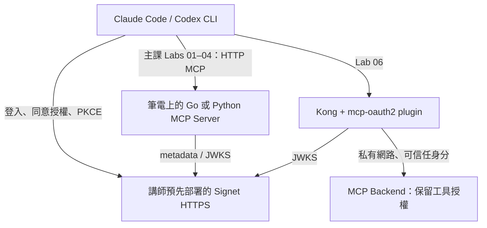

# MCP OAuth 2.0 Workshop

[](https://github.com/go-training/mcp-oauth2-workshop/actions/workflows/verify.yml?query=branch%3Amain)
[](https://github.com/go-training/mcp-oauth2-workshop/actions/workflows/trivy.yml?query=branch%3Amain)

讓 AI Agent、MCP Server 與 CLI 安全登入的實作工作坊。

90 分鐘主課依序完成 Lab 01–04、06 五個關卡：觀察沒有授權的 MCP Server、透過 OAuth 2.0 + PKCE 登入、驗證 Token 與權限，以及把入口授權集中到 Kong Gateway。Lab 05 的 Token 撤銷保留為課後進階選修。教材以 **[MCP Authorization 2026-07-28](https://modelcontextprotocol.io/specification/2026-07-28/basic/authorization/index)** 為基準。

- 活動：[Hello World Dev Conference 2026](https://hwdc.ithome.com.tw/2026/lab/4993)
- 時間：2026/10/14；13:00–13:30 環境準備，13:30–15:00 正式課程（活動頁另列 10/15 同內容場次）

## 你需要選擇的三件事

| 選擇     | 選項                            | 備註                                   |
| -------- | ------------------------------- | -------------------------------------- |
| 語言     | Go **或** Python                | 兩條路線教學行為等價，選一種就好       |
| AI CLI   | Claude Code **或** Codex CLI    | 需要自己的帳號；範例不需要模型 API key |
| 作業系統 | macOS / Linux / Windows（WSL2） | Windows 請在 WSL2 內操作               |

## 上課前檢查清單

請在 **10/14 前** 完成，現場 30 分鐘只留給排除狀況：

- [ ] 安裝 Git、curl、編輯器
- [ ] 安裝 **Go 1.26 或 1.27**，或 **Python 3.12（建議；3.11 以上可用）+ [uv](https://docs.astral.sh/uv/)**
- [ ] 安裝 Claude Code 或 Codex CLI，並確認能登入、能對話
- [ ] 能登入 [Signet](https://signet.wu-boy.com/)（講師已部署，你不用自己安裝）
- [ ] 完成下方「快速開始」，並成功看到第一次呼叫（見 [預期結果](#預期結果)）
- [ ] 先讀過 [建立自己的 Client App](docs/signet-client-app.md)，Lab 01 會用到
- [ ] （選做，要自己操作 Lab 06 才需要）依 [Lab 06 課前建置](labs/06/README.md#1-課前確認環境並建置映像) 在自己電腦 build 一次映像

Lab 06 使用 Docker Compose v2 以上與 Python 3 設定產生器。Kong 與 backend 映像沒有預先發佈，要自行操作的學員需安裝並啟動 Docker Engine／Docker Desktop（含 Compose），並在**課前於自己電腦完成一次 build**，現場不應依賴網路建置；不操作的學員可跟看講師展示。

## 快速開始

### 1. 取得程式碼並設定環境變數

```bash
git clone https://github.com/go-training/mcp-oauth2-workshop.git
cd mcp-oauth2-workshop
cp .env.example .env
chmod 600 .env
```

編輯 `.env`：

| 變數                     | 怎麼填                                                                                               |
| ------------------------ | ---------------------------------------------------------------------------------------------------- |
| `SIGNET_ISSUER`          | **保持預設** `https://signet.wu-boy.com`（結尾不要加斜線）                                           |
| `OAUTH_CLIENT_ID`        | 填入你自己的 Client App ID（Lab 01 建立並確認 active 後取得）；設定尚未完成時可先用講師提供的備援 ID |
| `GATEWAY_SHARED_SECRET`  | 先留空，Lab 06 才使用                                                                                |

> **每開一個新終端都要重新載入 `.env`**，否則 Lab 會讀不到設定：
>
> ```bash
> cd mcp-oauth2-workshop   # 一律在 repo 根目錄執行
> set -a; source .env; set +a
> ```
>
> `scripts/` 不會自動讀取 `.env`，所以每個終端都要自己載入。

### 2. 安裝依賴（選一種語言）

```bash
# Go
(cd go && go mod download)

# 或 Python
uv sync --project python --frozen
```

### 3. 啟動 Lab 01 並呼叫看看

終端 A — 啟動 Server（保持執行）：

```bash
./scripts/lab.sh 01 go        # 或：./scripts/lab.sh 01 python
```

終端 B — 另開一個終端，載入 `.env` 後呼叫：

```bash
./scripts/oauth.sh go call --token-file .tokens/anonymous.json
# Python 路線：./scripts/oauth.sh python call --token-file .tokens/anonymous.json
```

> 兩種語言的 Server 都使用 port 8000，**同一時間只能跑一個**。要換語言或換關，請先在終端 A 按 `Ctrl-C` 停掉舊的。記憶體中的筆記會隨之清空，這是正常的。

### 預期結果

終端 B 成功呼叫並印出 MCP 工具回應，代表環境就緒。如果失敗，先看 [故障排除](docs/troubleshooting.md)（常見原因：忘了載入 `.env`、port 8000 被占用、沒有在 repo 根目錄執行）。

之後依 [Claude Code / Codex CLI 設定](docs/clients.md) 把 AI CLI 連上你的 Server，再從 Lab 01 開始。

## 課程路線

主課順序為 **01 → 02 → 03 → 04 → 06**；保留原編號，Lab 05 為課後選修。每一關都可以獨立啟動，不依賴前一關對程式碼的修改。只有 Lab 04 會同時開 A/B 兩個 Server。

| Lab                     | 你要做什麼                                                        | 完成的標準                                                          | 時間  |
| ----------------------- | ----------------------------------------------------------------- | ------------------------------------------------------------------- | ----- |
| [01](labs/01/README.md) | 呼叫沒有授權的 MCP；登入 Signet、建立自己的 public Client App     | 工具呼叫成功（因為沒有保護）；App active 且設定完整                 | 10 分 |
| [02](labs/02/README.md) | 從 401 一路追到 Protected Resource Metadata，再到 Signet metadata | 能說出「Client 怎麼知道要去哪裡登入」                               | 15 分 |
| [03](labs/03/README.md) | PKCE 登入，並看 Server 如何驗 Token                               | 登入後呼叫成功；知道驗了簽章、issuer、audience、expiry、access type | 25 分 |
| [04](labs/04/README.md) | 觀察 scope 與 resource 隔離                                       | 缺少寫入權限被擋；A 的 Token 打不進 B                               | 20 分 |
| [06](labs/06/README.md) | 把入口授權交給 Kong Gateway                                       | 對照「Server 自己授權」與「Gateway 集中授權」的差異                 | 10 分 |

主課實作共 80 分鐘，另留 5 分鐘排錯緩衝與最後 5 分鐘 Q&A。

課後進階選修：[Lab 05：撤銷同一顆 Token](labs/05/README.md)，沿用既有 public Client 練習撤銷，不需 secret 或額外 App，不列入主課驗收。

課堂只需提醒：Token 撤銷後，本地驗 JWT 的 Server 不一定立即知道；需要即時撤銷時，再進一步研究 introspection。

**關於你的 Client App**：新版 Signet 可自行填入 notes scopes 與 allowed resources，註冊頁明示立即啟用。Lab 01 建立後務必重新開啟詳情／編輯頁複核，Lab 03 使用自己的 ID。若現場顯示 pending 或設定有問題，請助教協助，必要時使用備援 ID。

## 先備概念速查

不熟這些詞也沒關係，Lab 會逐一示範。

| 名詞                          | 一句話                                                         |
| ----------------------------- | -------------------------------------------------------------- |
| Authorization Server (Signet) | 負責讓你登入、發 Token 的服務                                  |
| Resource Server (MCP Server)  | 持有資料／工具，收到 Token 後決定放不放行                      |
| Client (Claude Code / Codex)  | 代表你去登入、帶 Token 呼叫 MCP 的程式                         |
| PKCE                          | 防止授權碼被攔截後冒用的機制，public Client 沒有 secret 時必備 |
| scope                         | Token 被允許做的事，如 `notes:read`、`notes:write`             |
| audience / resource           | Token 是發給哪一個 Server 用的，A 的 Token 不能拿去打 B        |
| JWKS                          | Server 用來驗證 Token 簽章的公鑰集合                           |

## 架構



Client、Authorization Server、Resource Server 各自有清楚的責任。登入永遠由 Client 自己完成，Kong 不會代替使用者登入。Kong 只在主課最後的 Lab 06 出現，Lab 01–04 與課後選修 Lab 05 不需要安裝。

## 程式碼怎麼讀

這是**完整可執行的完成版**。你的任務不是手刻 OAuth 或 JWT，而是修改設定、觀察請求，並驗證各種拒絕情境。每關的 README 會標出該閱讀哪些函式。

| 內容                                | Go                                          | Python                                 |
| ----------------------------------- | ------------------------------------------- | -------------------------------------- |
| 六個可執行 Lab 入口                 | [go/labs](go/labs)                          | [python/labs](python/labs)             |
| MCP 與授權實作（共用）              | [server.go](go/internal/workshop/server.go) | [server.py](python/workshop/server.py) |
| PKCE / MCP 呼叫 / 撤銷的參考 Client | [oauth/main.go](go/cmd/oauth/main.go)       | [oauth.py](python/workshop/oauth.py)   |

Server 提供三個工具：`whoami`、`list_notes`、`create_note`。筆記只存在記憶體、依使用者隔離，不涉及真實資料。

## 卡住了怎麼辦

1. 先查 [故障排除](docs/troubleshooting.md)。
2. 確認這四件事：在 repo 根目錄、已載入 `.env`、舊的 Server 已 `Ctrl-C`、`SIGNET_ISSUER` 沒有結尾斜線。
3. 舉手找助教，並告訴他：你在第幾關、執行了什麼指令、看到什麼錯誤（**不要貼完整 Token**）。
4. 如果 Claude Code / Codex 的瀏覽器登入有狀況，可改用參考 Client（`./scripts/oauth.sh`）完成該關練習。

## 安全注意事項

- Token 檔案權限為 0600 且已被 Git 忽略。**不要把完整 Token 貼進聊天、截圖或投影片。**
- `.env` 含有憑證，不要提交。
- 課後請只移除這次新增的 workshop MCP 設定，不要動到其他專案的 server 設定。

## 設計取捨（進階，可課後閱讀）

- 授權與 MCP 傳輸層皆以 2026-07-28 為準：授權流程（discovery、PKCE、`resource` 參數、`iss` 檢查、scope 與 403 `insufficient_scope`）照授權規範；傳輸層已取消 `initialize` 交握，每個請求都帶 `MCP-Protocol-Version`、`Mcp-Method`、`Mcp-Name` 與 `_meta`。Go 使用 go-sdk v1.8.0（`Stateless: true`），Python 使用 `mcp` 2.3.0（`stateless_http=True`）。Claude Code / Codex CLI 的實際連線與工具呼叫結果見驗證紀錄；Client 可能使用 SDK 提供的舊版相容路徑，不能只憑 Connected 推論所用協定版本。
- 參考 Client 依 RFC 9207 檢查回呼的 `iss`：Signet 宣告 `authorization_response_iss_parameter_supported` 時，缺少 `iss` 就拒絕；有 `iss` 時必須與記錄的 issuer 完全相同。
- Lab 01 刻意沒有授權；Lab 02 刻意只回 discovery challenge、尚不接受 Token。這兩關是明確的教學中間狀態，不是 bug。
- Labs 03–05 使用 RS256 + JWKS，這是本教材的選擇，MCP 規範並未強制使用 JWT。所有受保護關卡從一開始就驗證 audience。
- Signet access token 必須是 `type=access`，refresh token 或 ID token 不能呼叫 MCP。
- 課後選修 Lab 05 以 public Client ID 撤銷 access token；Server 入口沿用 Lab 04 的離線 JWT 與 scope 檢查，不查詢 introspection。
- Lab 06 的 Kong plugin 是離線 JWT 驗證，**不保證即時得知撤銷狀態**。實務上需決定在哪一層提供撤銷檢查，Gateway 不會自動解決所有授權問題。
- `notes:read` 控制入口，`notes:write` 控制寫入工具；MCP Server 始終保留工具與資料的業務權限。
- 本機範例僅允許 loopback HTTP，遠端 issuer 一律 HTTPS。`ALLOW_INSECURE_ISSUER=1` 只供本機測試 fixture，不能用來跳過遠端 TLS。
- Device Flow 列為後續延伸主題，不在主課內。

## 文件與驗證

- [登入 Signet、建立自己的 Client App](docs/signet-client-app.md)
- [Claude Code / Codex CLI 設定](docs/clients.md)
- [故障排除](docs/troubleshooting.md)
- [驗證紀錄](docs/validation.md)：真實 Signet、兩套 AI CLI 登入與 Kong 容器的彩排狀態。本機測試通過不等於現場整合已完成。
- [講師：Signet 與現場準備](docs/instructor.md)（講師用）

想確認本機環境沒問題，可以跑自動測試（不需要現場帳密）：

```bash
./scripts/check.sh
```

它會啟動 Go / Python 的六個 Lab 與本機測試用 issuer，涵蓋協定呼叫、PKCE、錯誤 Token、scope、audience、使用者隔離、public Client 撤銷及離線驗證限制與 Gateway 信任邊界。

GitHub Actions 在 push、pull request 或手動執行時，會分別跑 Go 格式檢查、`go vet` 與 `go test -race`，以及 Python lint、pytest 和兩種 Compose profile 驗證。pytest 會同時測試 Go / Python，因此測試環境需要兩種語言。

獨立的 [Trivy workflow](.github/workflows/trivy.yml) 會在 push、pull request 或手動執行時，掃描 repository 的 Go / Python 相依套件漏洞與 secrets；發現 HIGH 或 CRITICAL 問題即失敗，包含尚無修復版本的漏洞。結果顯示於 Actions log，可透過上方 Trivy badge 獨立追蹤；此掃描不涵蓋建置後的容器映像。

## 參考

- [MCP Authorization 2026-07-28](https://modelcontextprotocol.io/specification/2026-07-28/basic/authorization/index)
- [Signet](https://signet.wu-boy.com/)
- [Kong MCP OAuth2 Plugin](https://github.com/go-signet/kong-mcp-oauth2)
- [Go MCP SDK](https://github.com/modelcontextprotocol/go-sdk)、[Python MCP SDK](https://github.com/modelcontextprotocol/python-sdk)
- [MCP 基礎工作坊](https://github.com/go-training/mcp-workshop)
