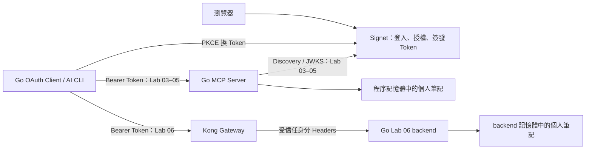
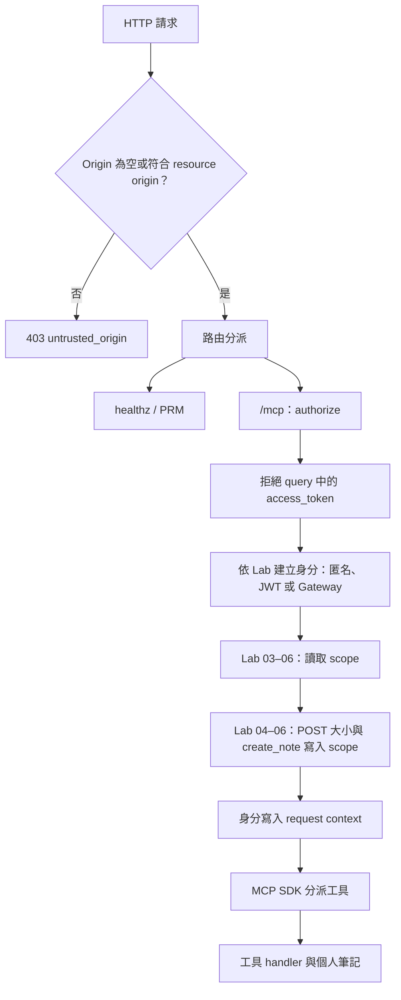
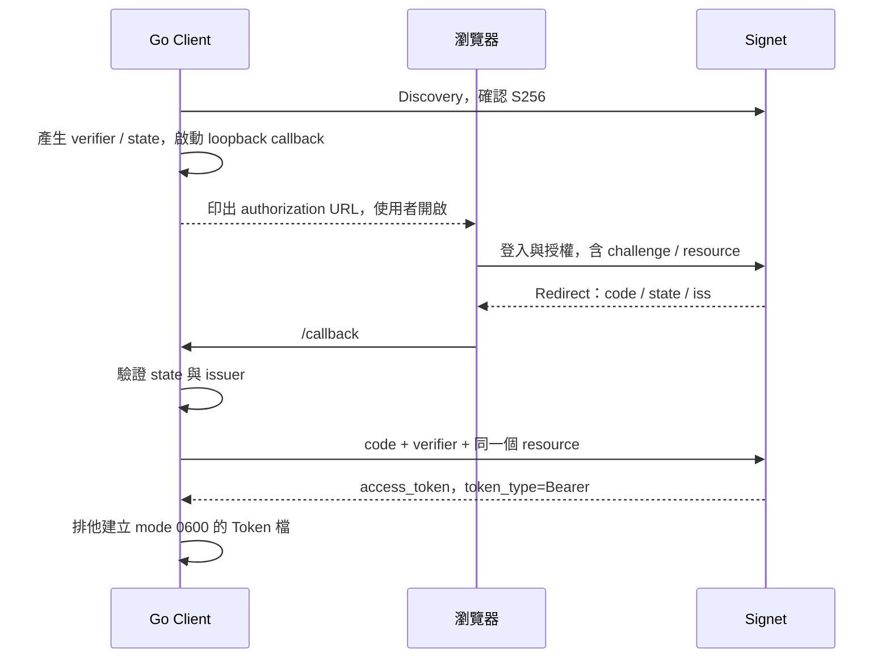

# Go 原始碼開發導讀

這份文件說明 Go 版本的程式結構、資料流、授權判斷與測試方式，供想理解或擴充實作的同仁參考。實際上課操作請搭配 [主課與課後選修教材](../README.md#課程路線)、[Signet Client App 設定](../docs/signet-client-app.md) 與 [故障排除](../docs/troubleshooting.md)。

Go 版本包含兩個可執行程式：MCP Resource Server，以及示範登入、呼叫與撤銷的 public OAuth Client。Signet 是外部 Authorization Server；本目錄不實作帳號登入、同意畫面或 Token 簽發。

## 1. 目錄與建議閱讀順序

| 檔案 | 職責 |
| --- | --- |
| [labs/01/main.go](labs/01/main.go) 至 [labs/06/main.go](labs/06/main.go) | 六個啟動入口，分別呼叫 `workshop.Run(1)` 至 `workshop.Run(6)` |
| [internal/workshop/server.go](internal/workshop/server.go) | 共用設定、Discovery、MCP 工具、HTTP 路由、JWT／scope／Gateway 檢查 |
| [cmd/oauth/main.go](cmd/oauth/main.go) | public Client：`login`、`call`、`revoke`、`metadata` |
| [internal/workshop/server_test.go](internal/workshop/server_test.go) | Go 單元測試：URL 限制與 HTTP 邊界 |
| [go.mod](go.mod)、[go.sum](go.sum) | 模組版本與依賴校驗資訊 |
| [Dockerfile](Dockerfile) | 建置 Lab 06 的 Go backend 映像 |
| [../tests/test_labs.py](../tests/test_labs.py) | 啟動 Go／Python 真實程序的黑箱整合測試 |

建議先讀一個 Lab 的 `main()`，再沿著 `Run → LoadConfig → NewHandler → authorize → 工具 handler` 往下看。理解 Server 後，再讀 Client 的 `main → login / call / revoke`，最後用測試對照成功與失敗案例。

六個入口沒有各自複製 Server。修改 `server.go` 會影響所有 Lab；功能差異由 `Config.Lab` 的條件判斷決定。`internal` 目錄也讓這個 package 僅供 Go 規則允許的模組內程式匯入。

## 2. 整體架構與責任



三個角色需要分開理解：

- **Authorization Server（Signet）**：決定使用者與 Client 可以取得哪些 scope、哪些 resource 的 Token。
- **OAuth Client**：取得 Token，並把 Token 放在 `Authorization: Bearer ...` 中呼叫 MCP。
- **Resource Server（Go MCP）**：驗證請求身分、用途與權限，再執行工具；Lab 06 將 Token 驗證交給 Gateway，但仍保留 backend 的信任與工具權限檢查。

Client App 的 Allowed Resources 應填可複製的完整 resource URL，例如 `http://localhost:8000/mcp`、Lab 04 B 的 `http://localhost:8001/mcp`、Lab 06 的 `http://localhost:9000/mcp`。它不是只有 host，也不是 callback URL。該值會串起授權請求的 `resource`、Token 的 `aud` 與 Server 的 `MCP_RESOURCE`。

## 3. 六個 Lab 如何共用程式

| Lab | 身分來源 | Go Server 的授權檢查 | 教學目的 |
| --- | --- | --- | --- |
| [01](../labs/01/README.md) | 固定 `anonymous` | 無 Token／scope 檢查，仍有共用的 Origin 與 query Token 邊界 | 觀察沒有授權的工具可被直接呼叫 |
| [02](../labs/02/README.md) | 不建立已登入身分 | `/mcp` 固定回 401，即使傳入有效 Token | 觀察 challenge 與 Protected Resource Metadata |
| [03](../labs/03/README.md) | JWT claims | JWT 簽章與 claims、讀取 scope | 建立可信身分；此階段 `create_note` 尚不要求寫入 scope |
| [04](../labs/04/README.md) | JWT claims | Lab 03 加上 `create_note` 寫入 scope | scope、使用者資料與 resource audience 隔離 |
| [05（課後選修）](../labs/05/README.md) | JWT claims | 沿用 Lab 04 的離線 JWT 與 scope 檢查 | Public Client 撤銷成功；離線驗證不保證立即拒絕 |
| [06](../labs/06/README.md) | Gateway headers | Gateway secret、issuer、audience、subject、讀／寫 scope | 授權入口移到 Gateway，backend 仍執行業務權限檢查 |

這不是逐關貼上程式的流程。每關都可獨立啟動，切換 Lab 就會建立新的 `app` 和筆記 map。Lab 06 也不是在 Lab 05 上再加 Gateway：Go backend 不再執行 JWT 驗證。

## 4. 啟動流程與設定

### 4.1 `Run` 與 `NewHandler`

`Run(lab)` 的流程如下：

1. `LoadConfig(lab)` 從環境變數組成 `Config`。
2. 建立 context，交給 `NewHandler` 與 JWKS 元件使用。
3. `NewHandler` 驗證 Lab 編號、resource 與該關必需的設定。
4. Labs 03–05 執行 issuer Discovery，取得 `jwks_uri`，建立 `keyfunc.NewDefaultCtx`。
5. 建立 MCP Server、註冊三個工具、組合 HTTP 路由與 middleware。
6. `Run` 建立 `http.Server` 並呼叫 `ListenAndServe()`。設定錯誤或 Server 停止會記錄錯誤並以 exit code 1 結束。

HTTP timeout 為讀 header 5 秒、讀取 15 秒、寫入 30 秒、idle 60 秒。程式目前使用 HTTP listener，未自行提供 TLS 或 signal 驅動的 graceful shutdown。

### 4.2 Server 環境變數

| 變數 | 預設值 | 用途 |
| --- | --- | --- |
| `LISTEN_ADDR` | `127.0.0.1:8000` | 程序實際綁定的介面與 port |
| `MCP_RESOURCE` | `http://localhost:8000/mcp` | 對外識別這個 MCP 的完整 URL，也是 audience 與 PRM 的 resource |
| `SIGNET_ISSUER` | 無 | Labs 02–05 的 issuer；Lab 06 比對 Gateway 的 issuer header |
| `READ_SCOPE` | `notes:read` | Labs 03–06 每個 `/mcp` 請求必需的 scope |
| `WRITE_SCOPE` | `notes:write` | Labs 04–06 呼叫 `create_note` 額外必需的 scope |
| `GATEWAY_SHARED_SECRET` | 無 | Lab 06 至少 32 字元的 Gateway 信任憑證 |
| `ALLOW_INSECURE_ISSUER` | 未啟用 | 設成 `1` 才允許本機 HTTP issuer／endpoint 測試替身 |

`LISTEN_ADDR` 與 `MCP_RESOURCE` 的用途不同。例如容器監聽 `0.0.0.0:8000`，但外部使用者透過 Kong 的 `http://localhost:9000/mcp` 存取，因此 resource 必須是後者。

Go 程式與 `scripts/lab.sh` 不會自行載入 `.env`。請先依根目錄教材準備 `.env`，再於 **repo 根目錄** 執行：

```bash
set -a
source .env
set +a
./scripts/lab.sh 03 go
```

每個終端需要各自載入環境。腳本會切換到 `go/` 再執行 `go run ./labs/03`；Lab 編號不能靠修改環境變數切換。

## 5. URL、Discovery 與 Metadata

### 5.1 兩種 URL 驗證的差別

`ValidateResource(raw)` 給 OAuth Client 使用；`NewHandler` 內也實作相同的 resource 限制：必須是絕對 URL、path 恰好為 `/mcp`，不得含帳密、query 或 fragment。允許 HTTPS，以及 hostname 為 `localhost` 或 `127.0.0.1` 的 HTTP。

`TrustedURL(raw)` 用於 issuer 與 Discovery 回傳的端點，拒絕缺少 host、內嵌帳密與 fragment；正常情況只接受 HTTPS。測試開關啟用後，才接受 `localhost`、`127.0.0.1` 或 `::1` 的 HTTP。注意 resource 的本機 HTTP 例外沒有包含 `::1`。

這些是程式現有的 URL 邊界，不代表所有 HTTPS 目的地都經過信任清單審核；Discovery 也沒有要求每個 endpoint 與 issuer 同源。issuer 設定本身必須可信。

### 5.2 `Discover(issuer)`

以帶路徑的 issuer `https://auth.example/team` 為例，候選順序為：

1. `https://auth.example/.well-known/oauth-authorization-server/team`
2. `https://auth.example/.well-known/openid-configuration/team`
3. `https://auth.example/team/.well-known/openid-configuration`

沒有 issuer path 時只使用前兩種。網路、HTTP 狀態或 JSON 解析失敗會嘗試下一個候選；若成功讀到 JSON 但 `issuer` 不完全相等，則立即失敗。尾端斜線也會影響字串相等判斷。

回傳資料中的 `jwks_uri`、authorization、token、revocation、introspection endpoint 若為字串，都會經過 `TrustedURL`。各使用端再檢查自身需要的欄位；這裡沒有實作完整 metadata schema 驗證。

Discovery 使用 5 秒 HTTP Client，且不跟隨 redirect。`readJSON` 要求 HTTP 200、關閉 body，最多讀取 1 MiB 供 JSON decoder 使用。JWKS 的取得與更新交由 `keyfunc` 套件管理，不要把這個 HTTP Client 的設定誤當成 JWKS 套件的設定。

### 5.3 Protected Resource Metadata（PRM）

Labs 02–05 提供以下兩個 GET 路由，內容相同；其他 method 回 405：

- `/.well-known/oauth-protected-resource/mcp`
- `/.well-known/oauth-protected-resource`

內容包含 `resource`、`authorization_servers`、`scopes_supported`、`bearer_methods_supported: ["header"]`。目前 `scopes_supported` 只列 `READ_SCOPE`；額外寫入需求會在 `create_note` 的 403 challenge 中列出讀與寫 scope。

`reject()` 對 401／403 加上 `WWW-Authenticate: Bearer ...`，其中 `resource_metadata` 指向帶 `/mcp` 的 PRM 路徑。Client 因而能由拒絕回應找到 resource 資訊，再找到 issuer。Lab 01 不提供 PRM；Lab 06 的公開 PRM 由 Gateway 負責。

## 6. 一個 MCP 請求如何被處理



圖中的檢查依 Lab 條件執行；Lab 02 在身分步驟直接回 401。實際程式位置是 `NewHandler` 最外層的 Origin wrapper，以及 `app.authorize`。

### 6.1 外層 HTTP 邊界

非空的 `Origin` 必須完全等於 `MCP_RESOURCE` 的 `scheme://host`；native CLI 通常不送 Origin，因此允許空值。此 wrapper 也涵蓋 health 與 metadata 路由，但它不是完整的瀏覽器 CORS 設定。

`/healthz` 不需 Token，只回 `ok`。`/mcp` 的 query 只要出現 `access_token`，即使值為空也回 400，避免把 Bearer Token 放入 URL。

### 6.2 JWT：`verify(raw)`

Labs 03–05 先要求 Authorization header 能拆成兩個欄位，且 scheme 為 Bearer（不分大小寫），再透過 `jwt.ParseWithClaims` 驗證：

| 檢查 | 實作行為 |
| --- | --- |
| 演算法與簽章 | 只接受 `RS256`，使用 Discovery 取得的 JWKS 驗證 |
| `iss` | 必須等於設定的 issuer |
| `aud` | 必須包含設定的 resource；可為字串或字串陣列 |
| `exp` | 必須存在且未過期 |
| `iat`、`nbf` | 存在時依 JWT 套件規則驗證；程式未要求它們一定存在 |
| `type` | 必須是 `access`，不可把 refresh Token 當 access Token |
| `sub` | 必須是非空字串 |
| `scope` | 必須是字串；是否包含所需權限由下一層檢查 |
| `jti` | 非必填；字串值用於 `token_id` 與日誌 |

驗證後組成 `identity`，而不是直接相信使用者傳入的 `X-MCP-*` headers。Labs 03–05 即使收到偽造的 subject header，仍採用已驗證的 JWT `sub`。

### 6.3 Scope 與雙層寫入檢查

`hasScope` 用 `strings.Fields` 拆解空白分隔的 scope，再做完整字串比對；不使用 substring。Labs 03–06 的所有 `/mcp` 請求都要求 `READ_SCOPE`，因此只有 `notes:write` 仍不足以通過。

Labs 04–06 的 POST 請求會先以 `http.MaxBytesReader` 讀取最多 1 MiB 的 body，再辨認 `method == "tools/call"` 且 `params.name == "create_note"` 的呼叫。缺少寫入 scope 時，middleware 回 403，並把需要的讀／寫 scope 放入 challenge。

讀過的 body 會重新放回 `r.Body`，讓 SDK 能再次解析。JSON 解析不成功時，此層不判斷工具名稱，交給 SDK 處理。`create_note` handler 內仍會再次檢查寫入 scope，確保業務操作自身也有權限邊界。

### 6.4 Lab 05：public Client 撤銷與離線驗證

Lab 05 的必做操作是由參考 Client 帶 `client_id` 撤銷 access token，不需 secret 或啟動 Server。保留的 Server 入口沿用 Lab 04 的 JWT、scope 與資料權限檢查，不查詢 introspection，也不要求額外憑證。

撤銷不會改變 JWT 簽章。尚未到期、其他檢查也通過的 Token，撤銷後仍可能被離線驗證接受；不能把撤銷 API 回 200 當作 MCP 已立即拒絕的證據。

### 6.5 Context 與日誌

通過檢查後，`authorize` 用 `context.WithValue` 與私有 `identityKey{}` 放入 `identity`。工具透過 `user(ctx)` 讀取身分，不需要重新解析 HTTP header。若 context 沒有身分，`user` 回零值；正常路由必須維持經過 middleware 的順序。

成功授權日誌記錄 Lab、subject、token ID 與 HTTP method；拒絕日誌記錄 Lab、HTTP status 與原因。這些日誌不印 raw Token，但「authorized request」代表通過 middleware，並不表示工具執行一定成功，也不是完整的業務稽核紀錄。

## 7. MCP 工具與資料模型

`NewHandler` 建立名稱為 `workshop-go-labXX`、版本 `1.0.0` 的 MCP Server，再用 `mcp.AddTool` 註冊三個工具。Streamable HTTP 設定為 `Stateless: true` 與 `JSONResponse: true`；HTTP transport 無 session 狀態，不代表業務資料沒有狀態。

| 工具 | 輸入 | 輸出與處理 |
| --- | --- | --- |
| `whoami` | 空物件 | `subject`、`scope`、`audience`，以及有值時的 `token_id`；不回 raw Token |
| `list_notes` | 空物件 | 目前 subject 的 `{"notes": [...]}` |
| `create_note` | `{"text": "內容"}` | 驗證權限與長度後追加，回該 subject 的完整筆記陣列 |

### 7.1 為什麼 `whoami` 手寫 Output Schema？

JWT 的 `aud` 可以是字串或字串陣列，所以 `identity.Audience` 使用 `any` 並保留原本的資料形狀。但自動推導可能產生部分 MCP Client 不接受的 boolean schema。

因此 `identitySchema` 明確將 audience 宣告為 `anyOf`：字串，或元素為字串的陣列。這樣能保留兩種合法值，也讓 Client 在 `tools/list` 階段取得具體 schema。新增含 `any` 的輸出時，要同時檢查工具執行結果與 Client discovery 相容性。

### 7.2 筆記隔離與並行

`app.notes` 是 `map[string][]string`，key 為 subject。每個 `app` 自己持有 map，讀寫時使用同一把 `sync.Mutex`，避免並行請求造成 map race。回傳時複製 slice，避免把內部底層陣列直接交出去；沒有筆記時回 `[]`，不是 `null`。

`create_note` 以 rune 計算 1–500 的長度，不是 UTF-8 byte 數，也不是視覺上的字形數。每個 subject 最多 100 筆。沒有資料庫、刪除、修改或跨程序同步；重啟會清空。Lab 01 全部人都是 `anonymous`，因此共用同一份匿名筆記。

## 8. OAuth 參考 Client

來源為 [cmd/oauth/main.go](cmd/oauth/main.go)。它刻意把 OAuth 步驟直接寫出，方便觀察 PKCE、state 與 resource 綁定；它不是完整的通用 MCP Client，也沒有自動從 401 觸發登入、refresh Token 更新或動態註冊 Client。

### 8.1 指令入口與參數

建議從 **repo 根目錄** 使用 [scripts/oauth.sh](../scripts/oauth.sh)。腳本先編譯到 `.build/oauth`，再將操作轉成 `-command`，Token 相對路徑固定以 repo 根目錄為基準。直接在 `go/` 執行 `go run ./cmd/oauth` 時，相對路徑則以當下目錄為基準。

| 參數 | 預設值／用途 |
| --- | --- |
| `--command` | `call`；也支援 `login`、`revoke`、`metadata`，wrapper 會替你傳入 |
| `--issuer` | `SIGNET_ISSUER` |
| `--resource` | `MCP_RESOURCE`，未設定則 `http://localhost:8000/mcp` |
| `--client-id` | `OAUTH_CLIENT_ID`，預先註冊的 public Client |
| `--scopes` | 固定預設 `notes:read`；不會自動讀取 Server 的 `READ_SCOPE` |
| `--token-file` | `.tokens/access.json` |
| `--callback-port` | `8765`；callback 為 `http://127.0.0.1:8765/callback` |
| `--tool` | `whoami`；也可指定其他工具名稱 |
| `--text` | `Hello workshop`，只在 `create_note` 組成輸入 |
| `--allow-cross-resource` | 預設關閉；Lab 04 的本機錯誤 audience 練習使用 |

Client 的 HTTP 請求 timeout 為 10 秒且不跟隨 redirect。瀏覽器導向登入頁的流程由使用者開啟 URL 後進行，不是由這個 HTTP Client 跟隨。

### 8.2 `login`：Authorization Code + PKCE



詳細邏輯：

1. 驗證 resource、Client ID，且拒絕覆寫已存在的 Token 檔。
2. `Discover` 取得 authorization／token endpoint；metadata 必須宣告支援 PKCE `S256`。
3. `random()` 使用 48 bytes 的密碼學亂數，分別產生 verifier 與 state。challenge 為 verifier 的 SHA-256，再做無 padding 的 URL-safe Base64。
4. callback listener 只綁 `127.0.0.1`。port 設成 `0` 時由系統選 port，主要供測試；實際 App 的 redirect 設定仍需接受該 URI。
5. 印出登入 URL，由使用者手動開啟。參數包含 `response_type=code`、Client ID、redirect URI、scope、state、challenge、`code_challenge_method=S256` 與 resource。
6. callback path 與 state 必須符合；state 使用 constant-time comparison。等待上限 180 秒。網頁顯示 callback received 只代表收到回呼，換 Token 是否成功仍以終端結果為準。
7. 回呼有 error 或缺少 code 時失敗。若 metadata 宣告支援 authorization response `iss`，回呼必須含此欄位；只要收到 `iss`，就必須與設定完全相等。
8. 用 code、verifier、Client ID、相同 redirect URI 與 resource 換 Token。此 public Client 不傳 Client secret。
9. 要求非空 access Token 與 Bearer token type，建立父目錄（新目錄 mode 0700）及 Token 檔（mode 0600、`O_EXCL` 防覆寫）。既有父目錄的權限不會自動修正。

Token 檔只包含 `access_token`、`issuer`、`resource`，不保存 refresh Token，也沒有加密。登入階段不自行驗證 JWT claims；使用 Token 時由 Resource Server 驗證。

### 8.3 `call`：resource 綁定與 MCP 請求

`call()` 先驗證目的 URL，再讀取 Token 檔。檔案不存在時允許匿名呼叫，以支援 Lab 01；其他讀檔／JSON 錯誤會失敗。有 access Token 時，檔案記錄的 resource 必須與目的地完全相同，否則在發送前拒絕。

`--allow-cross-resource` 可略過這個 Client 端相等檢查，但只允許目標 hostname 為 `localhost` 或 `127.0.0.1`，且仍經 URL 驗證。它不會改寫 Token 的 audience，也不會讓 Server 放寬 JWT 檢查。

程式使用常數 `protocolVersion = "2026-07-28"`。目前實作直接送 `tools/call`，不先送 initialize；每個請求都帶版本與 Client metadata：

- HTTP headers：`Accept`、`Content-Type`、`Mcp-Protocol-Version`、`Mcp-Method`、`Mcp-Name`，以及有 Token 時的 `Authorization`。
- JSON-RPC：`jsonrpc: "2.0"`、`id: 1`、`method: "tools/call"`。
- `params`：工具名稱、arguments，以及包含 protocolVersion、clientInfo、clientCapabilities 的 `_meta`。

`rpc()` 負責序列化 JSON 與 POST。`call()` 最多讀取 1 MiB 回應並印出 HTTP status、challenge 與 body。非 200、JSON 解析失敗、JSON-RPC `error` 或工具 `result.isError` 都會讓 CLI 以非零狀態結束；因此 HTTP 200 不等於工具成功。此 Client 只解析 JSON 回應，未實作完整 SSE 消費或完整 JSON-RPC schema 驗證。

### 8.4 `metadata` 與 `revoke`

`metadata` 直接呼叫 `Discover`，將 issuer metadata 印成 JSON，方便排查端點設定。

`revoke` 讀取 Token 檔，先比對檔案 issuer 與目前設定，再透過 Discovery 找到 revocation endpoint，POST public `client_id`、access Token 與 token type hint。此範例不傳 Client secret，要求回應 HTTP 200，但不解析 response body。

撤銷成功後刻意保留檔案，方便用**同一顆 Token** 重試 Lab 05。撤銷不代表刪除本機檔案，也不代表所有只做離線 JWT 驗證的 Server 都會即時拒絕它。

### 8.5 用指令對照程式

以下在 repo 根目錄執行，先完成 App 設定並載入 `.env`。另一個終端需已啟動 Lab 04；撤銷操作沿用同一個 public Client ID，不需額外憑證。Token 檔名需尚未存在：

```bash
./scripts/oauth.sh go metadata
./scripts/oauth.sh go login --resource http://localhost:8000/mcp \
  --scopes 'notes:read notes:write' --token-file .tokens/go-guide.json
./scripts/oauth.sh go call --resource http://localhost:8000/mcp \
  --token-file .tokens/go-guide.json --tool whoami
./scripts/oauth.sh go call --resource http://localhost:8000/mcp \
  --token-file .tokens/go-guide.json --tool create_note --text '閱讀 Go 原始碼'
./scripts/oauth.sh go call --resource http://localhost:8000/mcp \
  --token-file .tokens/go-guide.json --tool list_notes
```

Lab 05 的撤銷前後對照：

```bash
./scripts/oauth.sh go revoke --token-file .tokens/go-guide.json
./scripts/oauth.sh go call --resource http://localhost:8000/mcp \
  --token-file .tokens/go-guide.json --tool whoami
```

最後一次在 Token 尚未到期且其他檢查通過時仍會成功，展示離線驗證的限制。切換 Server 會清空筆記，但不會自行刪除 Token 檔。

## 9. Lab 06：Gateway 與 Go backend 的信任邊界

[Dockerfile](Dockerfile) 使用 Go 1.26.9 建置 `./labs/06`，設定 `CGO_ENABLED=0` 與 `-trimpath`，再把單一執行檔放進 distroless nonroot 映像。因此此映像固定執行 Lab 06，無法靠 `LAB` 環境變數改成其他關卡。

[compose.yml](../labs/06/compose.yml) 將公開入口綁到 `127.0.0.1:9000`，Go backend 使用內部網路且不發布 host port。backend 的 resource 設為 `http://localhost:9000/mcp`，符合使用者看到的 Gateway URL。

[configure_gateway.py](../scripts/configure_gateway.py) 產生 Kong 設定、設定 issuer／resource／read scope，並配置 request-transformer 移除再加入 `X-Workshop-Gateway`。完整 Gateway 操作與外部 plugin 說明見 [Lab 06](../labs/06/README.md)；plugin 的 Token 驗證實作不在 `go/` 內。

Go backend 的 `authorize` 在 Lab 06 執行：

1. 以 constant-time comparison 比對 `X-Workshop-Gateway` 與 shared secret。
2. 從 `X-MCP-Subject`、`X-MCP-Scope`、`X-MCP-Audience`、`X-MCP-Token-Id` 建立身分。
3. 要求 subject 非空，`X-MCP-Issuer` 等於設定，audience header 等於 resource。
4. 繼續檢查讀取 scope、POST 大小及 `create_note` 寫入 scope。

backend 不會再驗證原始 Bearer Token，因此私有網路、secret 保密與 Gateway 產生可信身分 headers 都是此架構的一部分。只偽造 `X-MCP-Subject` 不會通過；若能取得 shared secret 並直接連線 backend，就能構造它信任的身分 headers。Lab 05 與 Lab 06 都不查詢撤銷狀態。

## 10. 錯誤要在哪一層追查

| 現象 | 原始碼位置／意義 |
| --- | --- |
| 啟動即 `configuration failed` | `NewHandler`：resource、issuer、JWKS或 Lab 06 secret 不符 |
| 400 `token_in_query_forbidden` | `authorize`：URL query 含 `access_token` |
| 401 `invalid_token` | Lab 02 固定拒絕；或 Labs 03–05 header／JWT 不符 |
| 401 `untrusted_gateway` | Lab 06 的 shared secret 未通過 |
| 401 `invalid_gateway_identity` | Lab 06 subject、issuer 或 audience 不符 |
| 403 `untrusted_origin` | 最外層 Origin 檢查；此回應不走 `reject` 的 Bearer challenge |
| 403 `insufficient_scope` | 缺少讀取或寫入 scope；查看 `WWW-Authenticate` |
| 413 `request_too_large` | Labs 04–06 POST body 讀取失敗或超過限制 |
| HTTP 200 但工具失敗 | SDK／工具層錯誤，例如內容長度不符、筆記上限；檢查 JSON-RPC error 或 `isError` |
| CLI `different resource` | Client 還未送出請求，Token 檔記錄的 resource 與目的地不符 |
| CLI `token file exists` | `login` 防覆寫；改用新的 Token 檔名 |

`writeJSON` 設定 JSON content type 與 `Cache-Control: no-store`。`reject` 只對 401／403 加 Bearer challenge；SDK 回應、health 回應與其他直接寫出的狀態不一定走這個 helper。

## 11. 測試與開發驗證

### 11.1 Go 單元測試

[server_test.go](internal/workshop/server_test.go) 包含：

- `TestValidateResource`：合法 HTTPS／本機 HTTP，以及 path、query、fragment、userinfo 等拒絕案例。
- `TestTrustedURL`：未啟用／啟用測試開關時的 issuer URL 邊界。
- `TestHandlerBoundary`：health、惡意 Origin 與 query Token。

在 `go/` 目錄執行：

```bash
go test ./...
go test -race ./...
go vet ./...
gofmt -l .
```

`gofmt -l` 預期沒有輸出。`go test -race` 只涵蓋實際執行到的 Go 測試路徑；它不會自動把下列 Python 測試啟動的 Go 程序變成 race build。

### 11.2 跨語言黑箱測試

[tests/test_labs.py](../tests/test_labs.py) 會建置六個 Go Server 與 OAuth Client，啟動本機 issuer fixture，產生 RSA key、JWKS 與測試 Token，再透過 HTTP 呼叫真實程序。相同案例會對 Go／Python 路線參數化執行。

| 測試組 | 驗證內容 |
| --- | --- |
| Lab 01 baseline | discovery、工具清單、匿名身分，以及 Go audience output schema 為物件 |
| Lab 02 discovery | 401 challenge、PRM 與即使有 Token 仍拒絕的教學行為 |
| Lab 03 tokens | 缺少 Token、過期／缺少 exp、錯誤 issuer／audience／type／subject、偽造簽章與 audience 兩種形狀 |
| Lab 03 boundaries | query Token、Origin 與偽造 subject header |
| Lab 04 isolation | 寫入 scope、Alice／Bob 個人筆記隔離、A／B audience 隔離 |
| Lab 05 revocation | 無額外憑證的啟動、JWT／scope 驗證與撤銷後的離線驗證限制 |
| Lab 06 boundary | 缺少 Gateway secret、有效 Gateway 身分、寫入 scope、錯誤 audience |
| Client lifecycle | PKCE、錯誤 callback state、resource 綁定、Token 檔權限、call／revoke／重試 |
| Client errors | 不安全目的地、非本機 cross-resource、HTTP 200 內的 JSON-RPC error |
| Gateway config | 設定產生器與路由／header 設定檢查 |

在 **repo 根目錄** 執行既有完整檢查入口：

```bash
./scripts/check.sh
```

它會依序做 Go formatting、vet、test，再同步 Python 依賴，執行 Ruff 與 pytest。若只想重跑黑箱測試：

```bash
uv sync --project python --frozen
uv run --project python --frozen pytest -q tests/test_labs.py
```

這些測試使用本機 issuer fixture，不會登入真實 Signet。Lab 06 邊界測試直接向 backend 傳 header，也不等同於啟動 Kong 完整驗證；真實瀏覽器登入、外部 AI CLI、Signet App 權限及 Gateway 部署仍需依教材驗收。

## 12. 想擴充功能時從哪裡開始

| 修改目的 | 主要位置 | 應保留的行為與驗證 |
| --- | --- | --- |
| 新增 MCP 工具 | `NewHandler` 的 `mcp.AddTool` | 定義 input／output 型別；需要額外 scope 時，同步考慮 HTTP challenge 與 handler 內的權限檢查 |
| 更改讀／寫權限 | `Config`、`LoadConfig`、`hasScope` 與工具檢查 | PRM、Signet App、Client `--scopes` 與測試必須一致；scope 以完整值比對 |
| 新增需授權的 HTTP 路由 | `NewHandler` 的 mux | 明確包上 `authorize`；目前只有 `/mcp` 使用它 |
| 增加 Token 驗證規則 | `verify` | 增加正／反例，避免只驗簽章卻漏掉 issuer、audience、用途或效期 |
| 修改 Discovery | `TrustedURL`、`Discover` | 保留 issuer 相等與 endpoint URL 檢查，驗證帶 path issuer 及 redirect 行為 |
| 加入資料庫 | `app.notes` 與兩個筆記工具 | 查詢必須使用可信 subject 隔離；不要讓工具輸入自行決定資料擁有者 |
| 調整 CLI 協定／參數 | `cmd/oauth/main.go` | 同步參考 Client 黑箱測試、協定 metadata 與操作文件 |
| 修改 Gateway 信任方式 | Lab 06 分支、Compose、設定產生器 | 同步驗證公開入口、私有 backend 與身分 header 來源 |

目前實作保留教學所需的最小功能：沒有永久儲存、總使用者容量限制、速率限制、完整稽核、refresh 流程或完整 MCP Client session 管理。準備延伸為實際服務時，應依需求補齊這些能力，並以各 Lab 已有的拒絕案例作為回歸基準。
