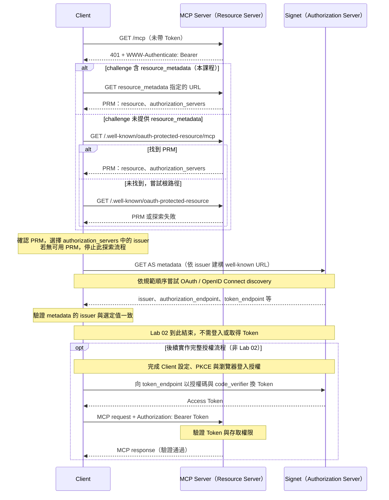

# Lab 02：授權探索：從 401 找到 Signet

[課程首頁](../../README.md) · [Go 入口](../../go/labs/02/main.go) · [Python 入口](../../python/labs/02/main.py)

完整實作：[Go](../../go/internal/workshop/server.go) / [Python](../../python/workshop/server.py)。每關都可直接執行，不需從上一關複製程式。

所有指令從 repo 根目錄執行。每個終端先選語言並載入設定：

```bash
export LAB_LANGUAGE=go  # 或 python
set -a
source .env
set +a
```

## 角色與 Sequence Diagram

| 角色                 | 本課程中的對應                                     | 責任                                                |
| -------------------- | -------------------------------------------------- | --------------------------------------------------- |
| Client               | MCP Client；本關用 `curl` 與 metadata 指令逐步觀察 | 探索 metadata，後續取得並攜帶 Access Token 呼叫 MCP |
| Resource Server      | `http://localhost:8000/mcp` 的 MCP Server          | 提供受保護資源、回傳 401 challenge，並公開 PRM      |
| Authorization Server | Signet                                             | 提供 AS metadata，後續處理登入、授權與簽發 Token    |

`/.well-known/oauth-protected-resource/mcp` 是 Resource Server 提供的 **Protected Resource Metadata（PRM）端點**，不是另一台伺服器。PRM 的 `resource` 識別受保護資源，`authorization_servers` 列出授權伺服器的 issuer；Client 再向選定的 issuer 探索 AS metadata，取得登入與換 Token 的端點。

以下依 [MCP Authorization Server Discovery 時序圖](https://modelcontextprotocol.io/specification/2026-07-28/basic/authorization/authorization-server-discovery#sequence-diagram) 改寫，套用本課程的角色與路徑：



Client 直接向兩台 Server 取得各自的 metadata；這段 discovery 不會由 Resource Server 代替 Client 登入或換 Token。**Lab 02 即使收到有效 Token 也仍回 401**，圖中的成功呼叫是後續流程示意。

## 操作

先停止 Lab 01；載入自己從 `.env.example` 建立的 `.env`，再啟動。此關不需要 Client ID，也不需登入，可同步補齊 Lab 01 的 App 設定：

```bash
./scripts/lab.sh 02 "$LAB_LANGUAGE"
```

另一個終端：

```bash
curl -i http://localhost:8000/mcp
curl -s http://localhost:8000/.well-known/oauth-protected-resource/mcp
./scripts/oauth.sh "$LAB_LANGUAGE" metadata
```

第一個請求預期 `401` 與 `WWW-Authenticate`；依其中 `resource_metadata` 取得 PRM。PRM 的 `resource` 是 `http://localhost:8000/mcp`，`authorization_servers` 指向 Signet；接著查看 Signet 的 `issuer`、`authorization_endpoint`、`token_endpoint`、`jwks_uri`、`code_challenge_methods_supported`。

### 逐項核對畫面

| 步驟           | 你應看到什麼                                                             | 看不到時先查                        |
| -------------- | ------------------------------------------------------------------------ | ----------------------------------- |
| `curl -i /mcp` | `401`、`WWW-Authenticate: Bearer`，含 resource_metadata URL              | 是否仍在跑 Lab 01                   |
| 讀 PRM         | resource 是 `http://localhost:8000/mcp`，authorization_servers 是 Signet | 是否錯用另一個 port 或 MCP_RESOURCE |
| `metadata`     | issuer、authorize/token/JWKS endpoints、S256                             | 新終端是否載入 .env、HTTPS 是否可達 |

此關沒有瀏覽器登入，也不會產生 Token 檔。看懂以上三份資訊即可停止 Server，進入 Lab 03。

## 觀察與練習

- Go：`NewHandler` 的 metadata 路由、`authorize` 的 Lab 02 分支、`Discover`。
- Python：`Authorization.__call__` 的 metadata／Lab 02 分支、`discover`。
- PRM 描述受保護資源；AS metadata 描述授權伺服器，兩者不是同一份文件。
- PRM 公開可讀，不需要先登入。兩種 well-known 路徑都提供；Client 應優先使用 challenge 指定的位置。
- 分辨誰回 401、誰顯示登入畫面、誰簽發 Token。

## 驗收

沿著 challenge → PRM → AS metadata 找到正確 Signet，看到 `S256`。本關是 discovery 檢查點，**即使帶有效 Token 也仍回 401**；不要在此關反覆登入或期待 CLI 可用，下一關才啟用驗證。
