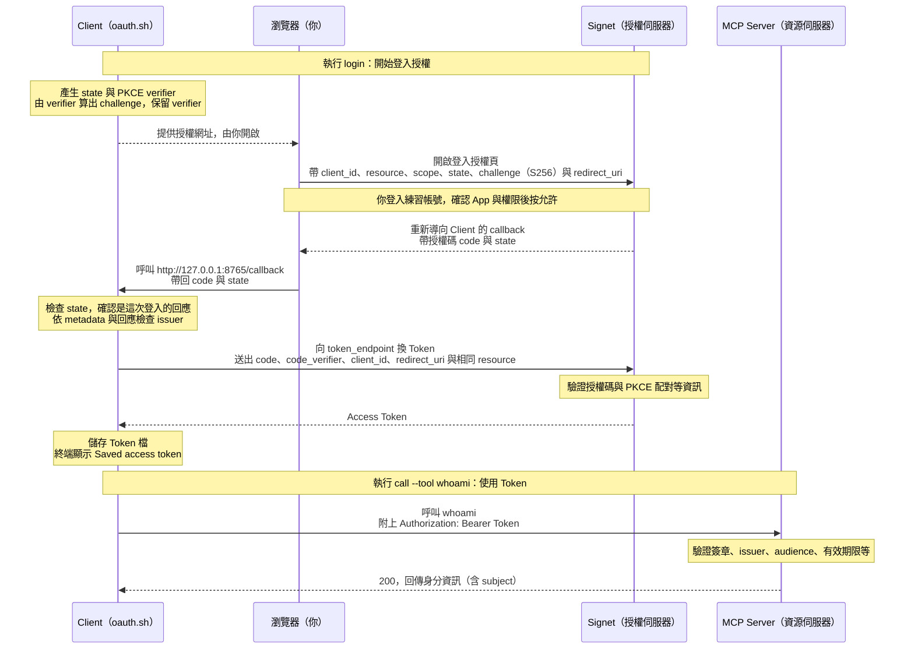

# Lab 03：Authorization Code + PKCE 與 Token 驗證

[課程首頁](../../README.md) · [Go 入口](../../go/labs/03/main.go) · [Python 入口](../../python/labs/03/main.py)

完整實作：[Go](../../go/internal/workshop/server.go) / [Python](../../python/workshop/server.py)。每關都可直接執行，不需從上一關複製程式。

## 本關目標

Lab 02 已找到 Signet 的登入與 Token 端點；Lab 03 要實際完成一次登入授權，讓 MCP Server 確認「你是誰」。

本關流程：**瀏覽器登入並允許授權 → Client 取得 Access Token → Client 帶 Token 呼叫 MCP Server → Server 驗證後回傳你的身分。**

完成後，你應能觀察到：未帶 Token 的請求回 `401`；帶有效 Token 呼叫 `whoami` 成功，結果中的 `subject` 是你登入的練習帳號識別值。不需要先讀懂 JWT 或 PKCE 的程式碼；讀取與寫入權限的差異留到 Lab 04 練習。

## 從登入到取得 Token 的 Sequence Diagram

接續 [Lab 02 的授權探索](../02/README.md#角色與-sequence-diagram)，本圖從 Client 已取得 Signet metadata 開始。Client 指本關的 `oauth.sh` 指令；瀏覽器讓你登入與確認授權；Signet 負責發 Token；MCP Server 負責驗證 Token 並執行工具。



看圖時先掌握三件事：

1. **瀏覽器帶回的是授權碼（code）。** Client 收到授權碼後，還要向 Signet 換取 Access Token，才完成 `login`。
2. **PKCE 讓換 Token 時能核對是否持有原先的 verifier。** Client 先送出由 verifier 算出的 challenge，之後換 Token 才送 verifier，讓 Signet 檢查兩者是否配對。本關 Client 會自動處理，不需手動計算。
3. **拿到 Token 後，才呼叫 MCP Server。** `call` 會讀取 Token 檔並附在請求中；Server 驗證通過後，`whoami` 才會回傳你的身分。

## 環境設定

所有指令從 repo 根目錄執行。每個終端先選語言並載入設定：

```bash
export LAB_LANGUAGE=go  # 或 python
set -a; source .env; set +a
```

## 進入本關前

先依 [Client App 教學](../../docs/signet-client-app.md) 確認自己的 App 已是 active，已加入 `notes:read notes:write` 與三個 allowed resources；把自己的 Client ID 填入 `.env` 並重新載入（`set -a; source .env; set +a`）。若自己的 App 尚未就緒，使用教學中的講師共用 App 備援，不要跳過授權檢查。

## 操作

停止上一關，啟動 JWT 驗證：

```bash
./scripts/lab.sh 03 "$LAB_LANGUAGE"
```

另一個已載入 `.env` 的終端：

```bash
./scripts/oauth.sh "$LAB_LANGUAGE" login --scopes notes:read --token-file .tokens/lab03-read.json
# 開啟終端顯示的授權網址，使用自己的練習帳號登入。
./scripts/oauth.sh "$LAB_LANGUAGE" call --token-file .tokens/lab03-read.json --tool whoami
```

登入指令會持續等待 callback，完成前不要在同一個終端輸入下一行 call。Go 會印出網址供手動開啟；Python 預設也會嘗試開瀏覽器。到 Signet 確認 App 名稱、`notes:read`、8000 resource、8765 callback，再按允許。回到終端看到 `Saved access token` 才執行 call。

若瀏覽器顯示 callback 錯誤，先看終端是否已存檔成功；本次 Chrome 擴充環境曾顯示 ERR_BLOCKED_BY_CLIENT，但 callback 已完成且 Token 換取成功。若未存檔，確認 CLI 仍在等待、port 8765 沒被占用，逾時後用新流程重試，不要重用舊授權網址。

Token 寫入本機 0600 檔案，不輸出 Token 本文。PKCE Client 綁定 `127.0.0.1:8765/callback`；必須先在 Signet 註冊這個 redirect URI。檔案已存在時程式拒絕覆寫，重練請改用新檔名。

接著依 [CLI 授權設定](../../docs/clients.md#lab-03-起預先註冊的-public-client) 用 Claude Code 或 Codex 登入，再呼叫 `whoami`。模型本身不接觸 client secret。

## 觀察與練習

### 1. 對照剛才的操作結果

| 操作                      | 你應看到什麼                                               | 代表什麼                                       |
| ------------------------- | ---------------------------------------------------------- | ---------------------------------------------- |
| 在 Signet 登入並允許授權  | 授權畫面顯示自己的 App、`notes:read` 與 8000 resource      | 你同意這個 App 代表你存取指定的 MCP Server     |
| 回到執行 `login` 的終端   | `Saved access token`，Token 存入 `.tokens/lab03-read.json` | Client 已取得 Access Token，後續呼叫可以使用它 |
| 執行 `call --tool whoami` | HTTP `200`，工具結果包含 `subject`                         | MCP Server 已驗證 Token，並辨識出你的身分      |

`subject` 是帳號的識別值，不一定是姓名或電子郵件。觀察工具回傳的身分即可，不需要打開 Token 檔或貼出 Token 內容。

### 2. 比較「不帶 Token」與「帶 Token」

保持 Lab 03 Server 執行，在另一個終端依序執行：

```bash
# 不帶 Token：即使剛才已在瀏覽器登入，仍應收到 401。
curl -i http://localhost:8000/mcp

# 帶上剛才取得的 Token：應收到 200，並在 whoami 結果看到 subject。
./scripts/oauth.sh "$LAB_LANGUAGE" call --token-file .tokens/lab03-read.json --tool whoami
```

重點：**瀏覽器登入完成後，每次呼叫 MCP Server 仍要帶有效的 Access Token。** 上面的 `call` 指令會讀取 Token 檔並自動附上授權資訊。

### 3. 用自己的話回答

1. **誰負責登入與發 Token？** Signet。Client 引導你到瀏覽器登入，授權完成後再換取 Token。
2. **MCP Server 如何知道你是誰？** 驗證請求中的 Token，從中取得 `subject`，再由 `whoami` 回傳身分資訊。
3. **為什麼登入後，`curl` 還是收到 401？** 這次 `curl` 沒有帶 Token；瀏覽器的登入狀態不會自動附到這個請求。

### 進階：了解驗證細節（選讀）

完成上面的比較就已掌握本關重點。想了解背後機制，再閱讀以下內容：

- **PKCE：保護授權碼換 Token 的過程。** Client 登入時送出 `code_challenge_method=S256` 與 challenge，換 Token 時送出對應的 `code_verifier`。本課程 Client 也會驗證 `state`；若 Signet metadata 未宣告支援 S256，則拒絕登入。
- **JWT 驗證：確認 Token 可信且適用於本 Server。** Server 使用 JWT 函式庫檢查 RS256 簽章、發行者（issuer）、適用對象（audience）及有效期限（expiry），並檢查 Signet `type=access` 與身分識別（subject）。
- **Client ID：辨識 App 的公開資料。** 它不是密碼或 client secret。本課程先在 Signet UI 註冊並啟用 App，再讓 CLI 使用這個 Client ID；這就是預先註冊（pre-registration），本關不需操作其他註冊方式（CIMD / DCR）。

想看程式碼時，依使用的語言選讀：

- Go：[Server](../../go/internal/workshop/server.go) 的 `verify`、`Discover`；[OAuth Client](../../go/cmd/oauth/main.go) 的 `login`。
- Python：[Server](../../python/workshop/server.py) 的 `Authorization.verify`、`discover`；[OAuth Client](../../python/workshop/oauth.py) 的 `login`。

也可從授權網址找出 `client_id`、`redirect_uri`、`state`、`code_challenge_method=S256` 與 `resource`，再對照 Client 換 Token 時帶的 `resource` 與 `code_verifier`。不要展示 callback 的授權碼（code）或 Token。

## 驗收

完成以下三項，就可以進入 Lab 04：

- [ ] 不帶 Token 呼叫 `/mcp`，收到 `401`。
- [ ] 完成登入授權後，終端顯示 `Saved access token`。
- [ ] 使用該 Token 呼叫 `whoami`，收到 `200`，結果中的 `subject` 是自己的練習身分。

進階驗證（選做）：執行 `./scripts/check.sh`，可重現偽造簽章、過期、錯 issuer、錯 audience、refresh token 被拒的情境。每個受保護的 MCP 請求都要帶授權，不能把 MCP session 當成登入憑證。
