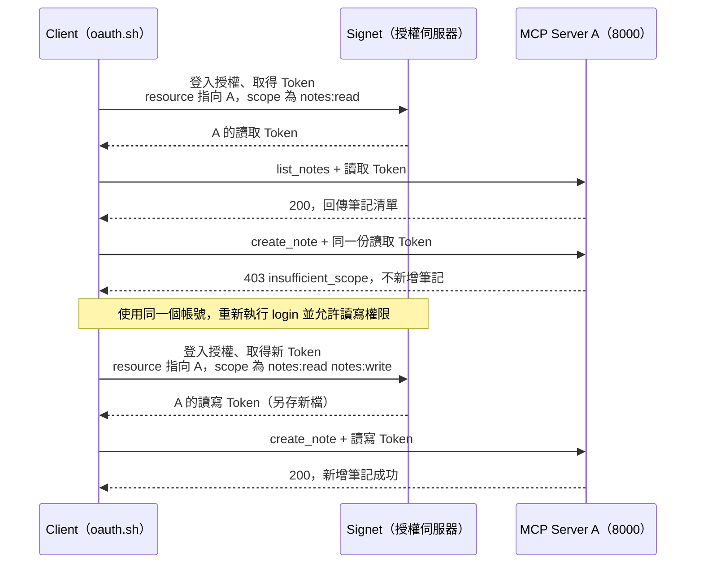
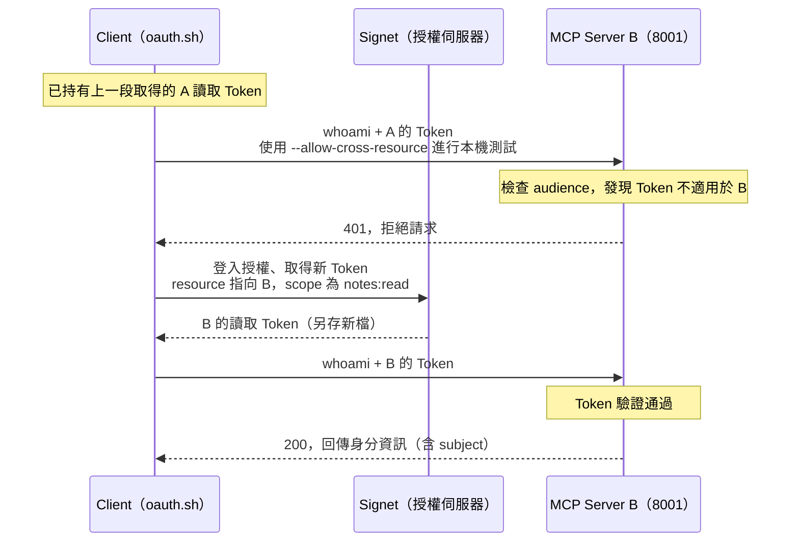

# Lab 04：scope 與 audience 隔離

[課程首頁](../../README.md) · [Go 入口](../../go/labs/04/main.go) · [Python 入口](../../python/labs/04/main.py)

完整實作：[Go](../../go/internal/workshop/server.go) / [Python](../../python/workshop/server.py)。每關都可直接執行，不需從上一關複製程式。

## 本關目標

Lab 03 已確認「你是誰」，本關要透過實際呼叫工具，確認「你能做什麼、能存取哪台 Server，以及能看到誰的資料」。不需要修改或閱讀程式碼。

- **權限（scope）：** 只有讀取權限時可以列出筆記，但不能新增；取得寫入權限後才能新增。
- **適用對象（audience）：** 給 Server A 的 Token，不能拿去存取 Server B。
- **帳號隔離（subject）：** 同一台 Server 上，不同帳號只能看到自己的筆記。

## 權限與適用對象的 Sequence Diagram

以下兩張圖對應接下來的兩組操作。圖中的「登入授權、取得 Token」包含 Lab 03 的瀏覽器登入與 PKCE 換 Token 流程，細節可回看 [Lab 03](../03/README.md#從登入到取得-token-的-sequence-diagram)。

### 1. scope：讀取成功，寫入需要額外權限



**觀察重點：** 補權限後要使用新取得的 Token；原本的讀取 Token 不會自動增加寫入權限。

### 2. audience：A 的 Token 不能用在 B



**觀察重點：** 即使是同一個帳號、同樣的讀取權限，也要取得適用於 B 的 Token。這裡的 `401` 是適用對象錯誤；上一張圖的 `403` 則是缺少寫入權限。

後面的帳號隔離練習會再確認：同一台 Server 收到不同帳號的有效 Token 時，會依 `subject` 回傳各自的筆記。

## 環境設定

所有指令從 repo 根目錄執行。每個終端先選語言並載入設定：

```bash
export LAB_LANGUAGE=go  # 或 python
set -a
source .env
set +a
```

## 操作：scope

先在終端 A 按 `Ctrl-C` 停止 Lab 03，再啟動本關。以下 Server A 用終端 A，Client 用終端 B，稍後 Server B 用終端 C；三個終端都先載入設定。

```bash
./scripts/lab.sh 04 "$LAB_LANGUAGE"
```

在終端 B 逐行執行。每次 `login` 都先完成瀏覽器授權，回到終端看到 `Saved access token`，再執行下一行。重新練習時請換新的 Token 檔名，程式不會覆寫已有檔案。

```bash
./scripts/oauth.sh "$LAB_LANGUAGE" login --scopes notes:read --token-file .tokens/lab04-read.json
./scripts/oauth.sh "$LAB_LANGUAGE" call --token-file .tokens/lab04-read.json --tool list_notes
./scripts/oauth.sh "$LAB_LANGUAGE" call --token-file .tokens/lab04-read.json --tool create_note --text '應該被拒絕'
# 上一步預期 403，指令非零退出是練習成功，不是程式故障。
./scripts/oauth.sh "$LAB_LANGUAGE" login --scopes 'notes:read notes:write' --token-file .tokens/lab04-write.json
./scripts/oauth.sh "$LAB_LANGUAGE" call --token-file .tokens/lab04-write.json --tool create_note --text '取得寫入權限後成功'
```

預期依序看到：列出筆記成功（`200`，剛啟動時是空清單）、新增被拒絕（`403`）、補上寫入權限後新增成功（`200`）。`403` 回應中的 `insufficient_scope` 表示這份 Token 的權限不足，需要重新授權取得含 `notes:write` 的 Token。

## 操作：resource / audience

保持 A 在 8000，另一個終端啟動 B：

```bash
MCP_RESOURCE=http://localhost:8001/mcp LISTEN_ADDR=127.0.0.1:8001 ./scripts/lab.sh 04 "$LAB_LANGUAGE"
```

從 Client 終端送 A 的 Token 給本機 B，這是明確的負向測試：

```bash
./scripts/oauth.sh "$LAB_LANGUAGE" call --resource http://localhost:8001/mcp --token-file .tokens/lab04-read.json --allow-cross-resource
# 預期 401；這個測試開關僅允許 loopback 目的地。
./scripts/oauth.sh "$LAB_LANGUAGE" login --resource http://localhost:8001/mcp --scopes notes:read --token-file .tokens/lab04-b.json
./scripts/oauth.sh "$LAB_LANGUAGE" call --resource http://localhost:8001/mcp --token-file .tokens/lab04-b.json
```

自己的 App 必須事先允許 A/B 兩個 resource，否則登入階段的 `invalid_target` 不是 Server 驗證 audience 的結果。

## 觀察與練習

### 1. 確認剛才新增的筆記真的存在

保持 Server A 與 B 執行，在終端 B 使用第一個帳號的讀取 Token：

```bash
./scripts/oauth.sh "$LAB_LANGUAGE" call --token-file .tokens/lab04-read.json --tool list_notes
```

**預期結果：** 收到 `200`，清單中有「取得寫入權限後成功」，沒有「應該被拒絕」。這表示讀取 Token 仍可讀資料，但先前被拒絕的新增操作沒有寫入筆記。

### 2. 對照兩種拒絕結果

把前面操作的輸出對照下表，不需額外修改設定：

| 你做的操作                            | 預期結果 | 本次結果的意思                 |
| ------------------------------------- | -------- | ------------------------------ |
| 用 A 的讀取 Token 在 A 新增筆記       | `403`    | Token 有效，但沒有寫入權限     |
| 用 A 的讀寫 Token 在 A 新增筆記       | `200`    | Token 有效，且具有寫入權限     |
| 把 A 的 Token 送到 B                  | `401`    | 這份 Token 的適用對象不是 B    |
| 為 B 重新登入，再用 B 的 Token 呼叫 B | `200`    | Token 的適用對象正確，驗證通過 |

### 3. 換帳號，確認筆記不會混在一起

這一步需要另一個可用的練習帳號；若沒有，請向講師取得。兩個帳號都連到 **Server A（8000）**，且過程中不要重啟 Server A，因為本課程的筆記保存在記憶體中，重啟就會清空。

先確認第一個帳號的身分：

```bash
./scripts/oauth.sh "$LAB_LANGUAGE" call --token-file .tokens/lab04-read.json --tool whoami
```

記下結果中的 `subject`。接著在瀏覽器登出 Signet，執行下列登入指令，開啟新授權網址並使用**第二個練習帳號**登入。若仍自動登入第一個帳號，可把新網址貼到無痕視窗完成授權。

```bash
./scripts/oauth.sh "$LAB_LANGUAGE" login --scopes notes:read --token-file .tokens/lab04-other-read.json
# 看到 Saved access token 後，再執行以下兩行。
./scripts/oauth.sh "$LAB_LANGUAGE" call --token-file .tokens/lab04-other-read.json --tool whoami
./scripts/oauth.sh "$LAB_LANGUAGE" call --token-file .tokens/lab04-other-read.json --tool list_notes
```

**預期結果：** 第二個帳號的 `subject` 與第一個不同，筆記清單看不到第一個帳號新增的「取得寫入權限後成功」；若第二個帳號還沒新增過筆記，會看到空清單。

最後再執行步驟 1 的指令，確認第一個帳號仍看得到自己的筆記。這樣才能確認資料確實依帳號隔離，而非 Server 重啟後資料被清空。不要交換彼此的 Token。

### 進階：閱讀實作或使用 AI CLI（選讀）

- Go：閱讀 [Server](../../go/internal/workshop/server.go) 的 `authorize` scope 分支與 `create_note` handler。
- Python：閱讀 [Server](../../python/workshop/server.py) 的 `Authorization.__call__` 與 `create_note`。

Server 先在 HTTP middleware 檢查工具所需權限，再由工具 handler 檢查一次。JWT audience 從 Lab 03 就有檢查，本關只是實際測試 Token 送到不同 Server 時會被拒絕。

若要用 Claude Code 或 Codex 重做練習，可參照 [Client 指引](../../docs/clients.md) 重新授權。兩者不一定會自動引導補上權限（step-up）；本關以上述 `oauth.sh` 指令的結果作為驗收依據。

## 驗收

完成以下項目，就達成本關目標：

- [ ] 只有讀取權限時，列出筆記成功，新增筆記回 `403`。
- [ ] 取得寫入權限後新增成功，重新列出筆記能看到新增內容。
- [ ] A 的 Token 呼叫 B 回 `401`；改用為 B 取得的 Token 後成功。
- [ ] 兩個帳號的 `subject` 不同；第二個帳號看不到第一個帳號的筆記，第一個帳號仍看得到。

完成後，在終端 A 與 C 分別按 `Ctrl-C`，停止 8000 與 8001；接著前往 [Lab 06](../06/README.md)。[Lab 05](../05/README.md) 是課後進階選修。
