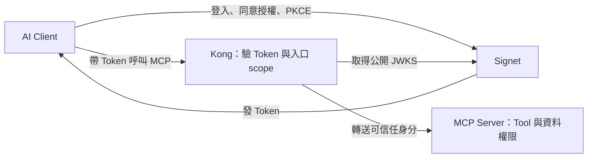

# Lab 06：Kong MCP Gateway

[課程首頁](../../README.md) · [Go 入口](../../go/labs/06/main.go) · [Python 入口](../../python/labs/06/main.py)

完整實作：[Go](../../go/internal/workshop/server.go) / [Python](../../python/workshop/server.py)。每關都可直接執行，不需從上一關複製程式。

所有指令從 repo 根目錄執行。每個終端先選語言並載入設定：

```bash
export LAB_LANGUAGE=go  # 或 python
set -a
source .env
set +a
```

## 為什麼要用 Kong MCP Gateway？

Lab 03–04 已經讓 MCP Server 自己驗證 Token。當團隊陸續開發筆記、訂單、庫存等多個 MCP 服務時，如果每個服務都各自處理 discovery、JWKS、JWT 驗證與入口 scope，這些共通邏輯就得在不同語言與專案中反覆設定、測試和維護。

**這一關把共通的入口驗證交給 Kong，讓 MCP 服務開發者專注於 Tool 與業務邏輯。** 本教材使用 Kong 搭配 `mcp-oauth2` plugin，集中提供 MCP 授權所需的入口能力。

- **減少重複實作**：Go／Python backend 不必各自維護 JWT 驗簽與 JWKS 取得邏輯。
- **統一入口政策**：在 Gateway 設定各服務接受的 issuer、resource 與入口 scope，方便集中檢查與調整。
- **減少服務直接暴露**：Client 連到 Gateway，backend 放在私有網路，由 Gateway 轉送通過入口檢查的請求。
- **分開維護責任**：入口驗證設定由 Gateway 維護，Tool 的輸入、輸出、資料存取與業務規則由各 MCP 服務維護。

本關只部署一個 MCP backend，先練習這個分工；相同架構可延伸到多個服務，但仍須為各服務設定正確的 route、resource 與權限。

## 哪些交給 Gateway，哪些留在 MCP Server？

| 責任                           | 本關由誰處理                      | 例子                                              |
| ------------------------------ | --------------------------------- | ------------------------------------------------- |
| 使用者登入、同意授權、發 Token | Signet；Client 執行 PKCE 登入流程 | Claude Code／Codex 取得 Token                     |
| 告訴 Client 去哪裡登入         | Kong + `mcp-oauth2` plugin        | 401 challenge 與 Protected Resource Metadata      |
| 驗證外部 Token 與入口 scope    | Kong + `mcp-oauth2` plugin        | 驗 JWT、issuer、audience、有效期限與 `notes:read` |
| 確認請求來自可信任 Gateway     | MCP backend                       | 檢查共享憑證與身分 headers                        |
| 判斷能否執行特定 Tool          | MCP backend                       | `create_note` 仍要求 `notes:write`                |
| 判斷能否存取特定資料           | MCP backend                       | 依 subject 隔離筆記，不能讀取別人的資料           |

所以可以把目標說成：**MCP 服務不用重做前面的 Token 驗證，但仍要決定這個使用者能操作哪些 Tool、哪些資料。** 登入與 Token 簽發仍由 Signet 負責，Kong 不會代替 Client 登入。



對照 Lab 04：原本同一個 MCP Server 同時負責「驗 Token」和「執行 Tool」；本關把前者移到 Kong。接上 Gateway 後，只有 `notes:read` 的使用者仍不能呼叫 `create_note`，因為入口通過不代表擁有所有工具權限。

### 為什麼 backend 可以信任 Gateway？

這關的 Go/Python backend 不自行驗 JWT，而是驗證 Gateway 共享憑證並讀取可信任身分。Compose 不發布 backend port，使用私有 network；Kong 覆寫 Gateway 憑證並驗證外部 Token。Kong admin API 關閉。

這些設定共同建立信任邊界。不能把 backend 直接開放給外部，再無條件相信呼叫者送來的 `X-MCP-Subject`；backend 仍會檢查 Gateway 憑證、必要身分欄位、issuer、audience 與 scope。

Gateway 也增加一個需要部署與維運的服務，入口故障會影響經過它的請求。若只有單一 MCP Server，Lab 04 的自行驗證方式仍可使用；有多個服務需要共用入口政策時，集中管理的好處更明顯。

## 操作

先停止 Lab 04 的 A/B Server（若曾啟動其他 Lab，也請先停止）。確認 `docker info` 與 `docker compose version` 成功；只有 Compose 指令存在、daemon 沒啟動仍不能操作。

課前在實際操作電腦下載／編譯映像（Go 路線也要有 `python3` 執行設定產生器）：

```bash
# 課前執行，可能需要數分鐘與網路；LAB_LANGUAGE 選 go 或 python。
docker compose --env-file .env -f labs/06/compose.yml --profile "$LAB_LANGUAGE" build
```

課堂啟動使用 `--no-build`，避免重抓 GitHub build context。若提示 image 不存在，先完成上面的課前建置。Docker Compose v2 以上必須可用。從 repo 根目錄、已載入 `.env` 的終端執行：

```bash
python3 scripts/configure_gateway.py
# 產生的 labs/06/.runtime/kong.yml 與 .env 都含本機憑證，已被 Git 忽略。
# 選一個 profile，不要同時啟動 go 與 python。
docker compose --env-file .env -f labs/06/compose.yml --profile "$LAB_LANGUAGE" up --no-build -d --wait --wait-timeout 120
curl -i http://localhost:9000/mcp
curl -s http://localhost:9000/.well-known/oauth-protected-resource/mcp
```

`--wait` 會等待容器就緒；若逾時先看下方 logs，不要立刻把 Empty reply 誤判成 OAuth 失敗。

預期 401 與正確 PRM。Kong 的 resource 是 `http://localhost:9000/mcp`，你必須事先在自己的 Signet App 加入這個 allowed resource。

```bash
./scripts/oauth.sh "$LAB_LANGUAGE" login --resource http://localhost:9000/mcp --scopes 'notes:read notes:write' --token-file .tokens/lab06.json
./scripts/oauth.sh "$LAB_LANGUAGE" call --resource http://localhost:9000/mcp --token-file .tokens/lab06.json
./scripts/oauth.sh "$LAB_LANGUAGE" call --resource http://localhost:9000/mcp --token-file .tokens/lab06.json --tool create_note --text '經過 Kong'
```

在 Claude Code／Codex 新增另一個名稱 `workshop-gateway`，URL 改成 `http://localhost:9000/mcp`，沿用 [public Client 登入方式](../../docs/clients.md)。必須重新為 Gateway resource 授權，不能沿用 8000 的 Token。

## 對照與練習：誰負責擋下請求？

前面的操作已經用 `notes:read notes:write` Token 成功呼叫工具。接下來用兩個拒絕情境，確認 **Kong 驗入口，MCP backend 管 Tool 權限**。選 Go 或 Python 一條路線完成即可。

### 練習 1：能進入口，不代表能使用所有 Tool

重新登入，這次只申請 `notes:read`。先呼叫 `whoami`，再用**同一個 Token 檔案**嘗試寫入筆記：

```bash
./scripts/oauth.sh "$LAB_LANGUAGE" login --resource http://localhost:9000/mcp --scopes notes:read --token-file .tokens/lab06-read.json
./scripts/oauth.sh "$LAB_LANGUAGE" call --resource http://localhost:9000/mcp --token-file .tokens/lab06-read.json --tool whoami
./scripts/oauth.sh "$LAB_LANGUAGE" call --resource http://localhost:9000/mcp --token-file .tokens/lab06-read.json --tool create_note --text '應被拒絕'
```

| 觀察          | 預期結果                     | 代表什麼                                              |
| ------------- | ---------------------------- | ----------------------------------------------------- |
| `whoami`      | 成功，回傳身分資訊           | Token 通過 Kong 的入口驗證，也通過 backend 的身分檢查 |
| `create_note` | HTTP 403，缺少 `notes:write` | MCP backend 仍會檢查個別 Tool 的權限                  |

**檢查點：** 同一顆 Token 可以查身分，卻不能寫筆記。這就是 MCP 服務仍需保留的業務權限判斷。

### 練習 2：有效的 Token，也可能不是發給這個入口的

這次取得發給 `8000` 的 Token，刻意拿去呼叫 `9000` 的 Gateway。登入前確認自己的 Signet App 已允許這兩個 resource；不需重啟 Lab 04 的 Server。

```bash
./scripts/oauth.sh "$LAB_LANGUAGE" login --resource http://localhost:8000/mcp --scopes notes:read --token-file .tokens/lab06-a.json
./scripts/oauth.sh "$LAB_LANGUAGE" call --resource http://localhost:9000/mcp --token-file .tokens/lab06-a.json --allow-cross-resource
```

**預期：** 登入成功後，第二行收到 HTTP 401。Kong 會檢查 audience，拒絕不是發給 Gateway resource 的 Token。

`--allow-cross-resource` 只是讓練習用 Client 送出這個刻意錯誤的請求，不會關閉 Kong 的驗證。若看到找不到 Token 檔案或登入失敗，請先處理第一行；那些錯誤不算通過這個練習。

**檢查點：** 說出練習 1 和練習 2 的差別：前者是「沒有寫入權限」，後者是「Token 發給了別的服務」。預期的 403／401 都會讓指令以非零狀態結束，這裡代表拒絕測試成功，不必為了讓指令成功而放寬權限。

### 練習 3：確認 Client 只能從 Gateway 進入

查看目前容器與對外發布的 port：

```bash
docker compose --env-file .env -f labs/06/compose.yml --profile "$LAB_LANGUAGE" ps
```

在 `PORTS` 欄確認：

- Kong 有 `127.0.0.1:9000->8000/tcp` 的主機 port 映射，Client 從這裡連入。
- 你選擇的 `mcp-go` 或 `mcp-python` 沒有主機 port 映射。若只看到 `8000/tcp`，那是容器 port，不代表已發布到主機。

**檢查點：** backend 沒有直接對外發布 port，且程式會檢查 Gateway 憑證，才能信任 Gateway 傳來的使用者身分。只加一個 `X-MCP-Subject: admin` header，不能取代這些檢查。

完成後試著回答：「如果明天新增一個訂單 MCP 服務，還需要自己寫 JWT 驗簽嗎？誰決定使用者能不能修改某筆訂單？」本關的分工是：JWT 驗證交給 Kong；訂單 Tool 與資料權限由訂單服務負責，並為新服務設定對應的 Gateway route、resource 與入口 scope。

## 撤銷限制：本關只需記住一件事

**Token 被撤銷，不代表本關的 Kong 會立刻拒絕它。** 本教材固定版本的 plugin 只做離線 JWT 驗證，不會在每次請求時向 Signet 查詢撤銷狀態。因此尚未到期、也符合其他檢查的 Token，撤銷後仍可能通過入口。

本關不做撤銷實作，也不以撤銷結果驗收；先完成上面的入口與 Tool 權限練習即可。想練習用既有 public Client 撤銷 Token，並觀察離線驗證的限制，可做課後選修 [Lab 05](../05/README.md)。

## 驗收與清理

### 完成前，確認這五件事

- [ ] 已用選擇的 Go **或** Python backend，透過 `9000` 成功查詢身分與寫入筆記。
- [ ] 只含 `notes:read` 的 Token 可以呼叫 `whoami`，但呼叫 `create_note` 收到 403。
- [ ] 發給 `8000` 的 Token 呼叫 `9000` 收到 401。
- [ ] 容器列表只有 Kong 發布主機 port，MCP backend 沒有主機 port 映射。
- [ ] 能用自己的話說明：「Kong 集中驗 Token 與入口權限，MCP 服務專注 Tool，並保留工具與資料權限檢查。」

### 結果不符合預期時

先看容器是否啟動，再查看最近的日誌：

```bash
docker compose --env-file .env -f labs/06/compose.yml --profile "$LAB_LANGUAGE" ps
docker compose --env-file .env -f labs/06/compose.yml --profile "$LAB_LANGUAGE" logs --tail 50
```

容器未啟動或連線失敗時，先修正啟動問題；有 HTTP 回應後，再核對使用的 Token 檔案、resource 與 scopes。找助教時提供失敗步驟和錯誤訊息，不要貼 Token、`.env` 或產生的 `kong.yml`。講師彩排結果另見 [驗證紀錄](../../docs/validation.md)。

### 練習完成後，停止容器

確認已完成驗收，再執行清理：

```bash
docker compose --env-file .env -f labs/06/compose.yml --profile "$LAB_LANGUAGE" down
docker compose --env-file .env -f labs/06/compose.yml --profile "$LAB_LANGUAGE" ps
```

**預期：** 第二行不再列出本關執行中的容器，Gateway 的 `9000` 入口停止服務。筆記存在 backend 記憶體中，容器移除後不會保留。這個步驟不會撤銷 Signet Token；若要重做練習，重新啟動容器，Token 過期時再登入。
