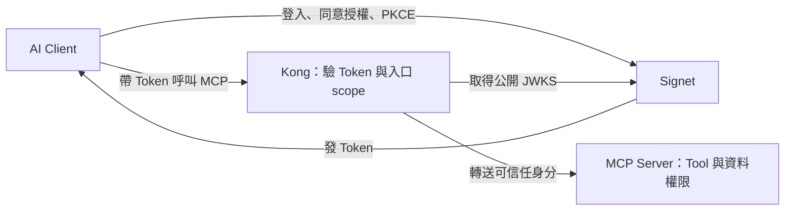

# Lab 06：Kong MCP Gateway

[課程首頁](../../README.md) · [Go 入口](../../go/labs/06/main.go) · [Python 入口](../../python/labs/06/main.py)

完整實作：[Go](../../go/internal/workshop/server.go) / [Python](../../python/workshop/server.py)。每關都可直接執行，不需從上一關複製程式。

所有指令從 repo 根目錄執行。每個終端先選語言並載入設定：

```bash
export LAB_LANGUAGE=go  # 或 python
set -a
source .env
set +a
```

## 為什麼要用 Kong MCP Gateway？

Lab 03–04 已經讓 MCP Server 自己驗證 Token。當團隊陸續開發筆記、訂單、庫存等多個 MCP 服務時，如果每個服務都各自處理 discovery、JWKS、JWT 驗證與入口 scope，這些共通邏輯就得在不同語言與專案中反覆設定、測試和維護。

**這一關把共通的入口驗證交給 Kong，讓 MCP 服務開發者專注於 Tool 與業務邏輯。** 本教材使用 Kong 搭配 `mcp-oauth2` plugin，集中提供 MCP 授權所需的入口能力。

- **減少重複實作**：Go／Python backend 不必各自維護 JWT 驗簽與 JWKS 取得邏輯。
- **統一入口政策**：在 Gateway 設定各服務接受的 issuer、resource 與入口 scope，方便集中檢查與調整。
- **減少服務直接暴露**：Client 連到 Gateway，backend 放在私有網路，由 Gateway 轉送通過入口檢查的請求。
- **分開維護責任**：入口驗證設定由 Gateway 維護，Tool 的輸入、輸出、資料存取與業務規則由各 MCP 服務維護。

本關只部署一個 MCP backend，先練習這個分工；相同架構可延伸到多個服務，但仍須為各服務設定正確的 route、resource 與權限。

## 哪些交給 Gateway，哪些留在 MCP Server？

| 責任                           | 本關由誰處理                      | 例子                                              |
| ------------------------------ | --------------------------------- | ------------------------------------------------- |
| 使用者登入、同意授權、發 Token | Signet；Client 執行 PKCE 登入流程 | Claude Code／Codex 取得 Token                     |
| 告訴 Client 去哪裡登入         | Kong + `mcp-oauth2` plugin        | 401 challenge 與 Protected Resource Metadata      |
| 驗證外部 Token 與入口 scope    | Kong + `mcp-oauth2` plugin        | 驗 JWT、issuer、audience、有效期限與 `notes:read` |
| 確認請求來自可信任 Gateway     | MCP backend                       | 檢查共享憑證與身分 headers                        |
| 判斷能否執行特定 Tool          | MCP backend                       | `create_note` 仍要求 `notes:write`                |
| 判斷能否存取特定資料           | MCP backend                       | 依 subject 隔離筆記，不能讀取別人的資料           |

所以可以把目標說成：**MCP 服務不用重做前面的 Token 驗證，但仍要決定這個使用者能操作哪些 Tool、哪些資料。** 登入與 Token 簽發仍由 Signet 負責，Kong 不會代替 Client 登入。



對照 Lab 04：原本同一個 MCP Server 同時負責「驗 Token」和「執行 Tool」；本關把前者移到 Kong。接上 Gateway 後，只有 `notes:read` 的使用者仍不能呼叫 `create_note`，因為入口通過不代表擁有所有工具權限。

### 為什麼 backend 可以信任 Gateway？

這關的 Go/Python backend 不自行驗 JWT，而是驗證 Gateway 共享憑證並讀取可信任身分。Compose 不發布 backend port，使用私有 network；Kong 覆寫 Gateway 憑證並驗證外部 Token。Kong admin API 關閉。

這些設定共同建立信任邊界。不能把 backend 直接開放給外部，再無條件相信呼叫者送來的 `X-MCP-Subject`；backend 仍會檢查 Gateway 憑證、必要身分欄位、issuer、audience 與 scope。

Gateway 也增加一個需要部署與維運的服務，入口故障會影響經過它的請求。若只有單一 MCP Server，Lab 04 的自行驗證方式仍可使用；有多個服務需要共用入口政策時，集中管理的好處更明顯。

## 操作

先停止 Lab 04 的 A/B Server（若曾啟動其他 Lab，也請先停止）。確認 `docker info` 與 `docker compose version` 成功；只有 Compose 指令存在、daemon 沒啟動仍不能操作。

課前在實際操作電腦下載／編譯映像（Go 路線也要有 `python3` 執行設定產生器）：

```bash
# 課前執行，可能需要數分鐘與網路；LAB_LANGUAGE 選 go 或 python。
docker compose --env-file .env -f labs/06/compose.yml --profile "$LAB_LANGUAGE" build
```

課堂啟動使用 `--no-build`，避免重抓 GitHub build context。若提示 image 不存在，先完成上面的課前建置。Docker Compose v2 以上必須可用。從 repo 根目錄、已載入 `.env` 的終端執行：

```bash
python3 scripts/configure_gateway.py
# 產生的 labs/06/.runtime/kong.yml 與 .env 都含本機憑證，已被 Git 忽略。
# 選一個 profile，不要同時啟動 go 與 python。
docker compose --env-file .env -f labs/06/compose.yml --profile "$LAB_LANGUAGE" up --no-build -d --wait --wait-timeout 120
curl -i http://localhost:9000/mcp
curl -s http://localhost:9000/.well-known/oauth-protected-resource/mcp
```

`--wait` 會等待容器就緒；若逾時先看下方 logs，不要立刻把 Empty reply 誤判成 OAuth 失敗。

預期 401 與正確 PRM。Kong 的 resource 是 `http://localhost:9000/mcp`，你必須事先在自己的 Signet App 加入這個 allowed resource。

```bash
./scripts/oauth.sh "$LAB_LANGUAGE" login --resource http://localhost:9000/mcp --scopes 'notes:read notes:write' --token-file .tokens/lab06.json
./scripts/oauth.sh "$LAB_LANGUAGE" call --resource http://localhost:9000/mcp --token-file .tokens/lab06.json
./scripts/oauth.sh "$LAB_LANGUAGE" call --resource http://localhost:9000/mcp --token-file .tokens/lab06.json --tool create_note --text '經過 Kong'
```

在 Claude Code／Codex 新增另一個名稱 `workshop-gateway`，URL 改成 `http://localhost:9000/mcp`，沿用 [public Client 登入方式](../../docs/clients.md)。必須重新為 Gateway resource 授權，不能沿用 8000 的 Token。

### 可直接執行的拒絕測試

```bash
./scripts/oauth.sh "$LAB_LANGUAGE" login --resource http://localhost:9000/mcp --scopes notes:read --token-file .tokens/lab06-read.json
./scripts/oauth.sh "$LAB_LANGUAGE" call --resource http://localhost:9000/mcp --token-file .tokens/lab06-read.json --tool create_note --text '應被拒絕'
# 預期 403，非零退出是成功驗收。
./scripts/oauth.sh "$LAB_LANGUAGE" login --resource http://localhost:8000/mcp --scopes notes:read --token-file .tokens/lab06-a.json
./scripts/oauth.sh "$LAB_LANGUAGE" call --resource http://localhost:9000/mcp --token-file .tokens/lab06-a.json --allow-cross-resource
# 預期 401。先確認上一步已成功存檔，否則只是在測試沒有 Token。
```

## 對照與練習

- 說明新增第二個 MCP 服務時，哪些驗證可沿用 Gateway 的做法，哪些 Tool／資料權限仍需由新服務實作。
- 檢查 [Kong 設定產生器](../../scripts/configure_gateway.py)：issuer、resource path、required scopes。
- PRM 路徑與 `/mcp` 都需要匹配 Kong route，`strip_path=false` 保留後端的 `/mcp`，`preserve_host=true` 保留 Client 入口 Host。
- Go `authorize` / Python `Authorization.__call__` 的 Lab 06 分支顯示 Gateway 信任邊界。
- 使用只含 `notes:read` 的新 Token，`create_note` 仍由 backend 回 403。
- 用 A（8000）的 Token 打 Gateway（9000），應回 401。
- 直接傳 `X-MCP-Subject: admin` 不能偽造身分；共用 header 只在 Gateway 信任邊界內使用。

## 撤銷限制

本次固定版本的 plugin 只做離線 JWT 驗證，**不具備即時撤銷能力**。不要以「接上 Kong」推論已解決撤銷；課堂提醒此限制即可；撤銷與 introspection 的取捨留到課後選修 [Lab 05](../05/README.md)，本 repo 不修改 plugin。

## 驗收與清理

能說出 Gateway 減少了哪些重複工作，以及為何 backend 仍需保留 Tool／資料權限。兩種 backend 各自透過 Kong 成功呼叫，錯 audience 被拒、工具 scope 仍有效、後端沒有 host port。容器實測狀態見 [驗證紀錄](../../docs/validation.md)。

```bash
docker compose --env-file .env -f labs/06/compose.yml --profile "$LAB_LANGUAGE" logs --tail 50
docker compose --env-file .env -f labs/06/compose.yml --profile "$LAB_LANGUAGE" down
```
