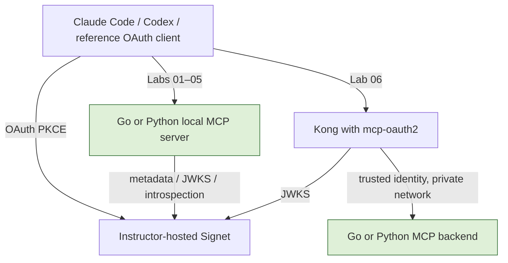

# MCP Authorization Workshop implementation plan

## Goal
Provide six runnable labs in Go and Python, using the MCP authorization specification dated 2025-11-25. Participants choose Claude Code or Codex CLI and one programming language. The instructor provisions a fresh shared Signet authorization server before class. Kong appears only in Lab 06. This implements the curriculum already agreed in the planning conversation.

## Architecture

## Scope
May modify this workshop repository only: README, labs, shared Go/Python implementation, reference clients, tests, Docker configuration, CI and instructor/client guides. Do not modify Signet, its SDKs, kong-mcp-oauth2, existing client configuration, or deploy a live server.

## Classification: CORE CODE
Authentication middleware is shared by the labs; mistakes teach unsafe patterns. Expected evolution and propagation are substantial. JWT validation, discovery trust boundaries, scope enforcement, revocation and gateway identity require line-by-line security review. The environment contains synthetic workshop data only. Automated checks complement instructor review; no human review is claimed.

## Implementation
- Official MCP SDKs; independently runnable lab entrypoints with shared transport/auth helpers.
- Same whoami/list_notes/create_note tools and per-subject in-memory data.
- Labs: baseline, discovery, PKCE + JWT, scopes + audience, revocation, Kong.
- Trusted issuer configured by instructor; RS256 JWT access tokens; exact issuer and audience; expiry; reject refresh tokens.
- Revocation uses Signet's documented introspection contract, checked without a positive cache.
- Reference Go/Python OAuth clients make protocol tests reproducible independently of AI model decisions.
- Public repository includes only example settings, no credentials. Live Signet URL is supplied later.

## Verification
1. Both languages negotiate MCP and call tools with a valid token.
2. Missing, forged, expired, wrong-issuer, refresh and wrong-audience tokens are rejected; insufficient scope yields 403.
3. Revoked token is rejected on its next request; introspection outage fails closed.
4. Metadata, PKCE resource binding, per-subject notes and gateway header spoof resistance checked.
5. Build/test Go, locked Python dependencies, format/lint, container configuration and docs commands checked where tools permit.
6. Live Signet and interactive Claude/Codex acceptance are explicitly pending until instructor supplies deployed service and test identities.

## Done
Runnable code for all 12 lab/language combinations, Chinese instructions, reproducible local tests, tested commit pushed to GitHub with accurate limitations. CI repeats the checks. No live deployment or fabricated integration success.
