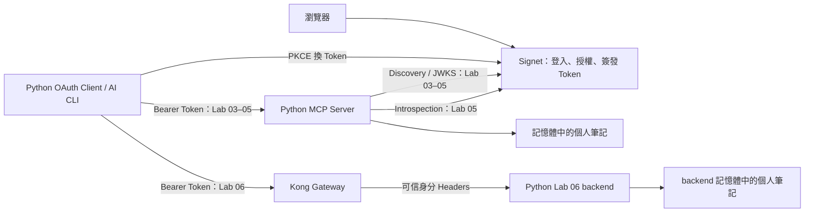
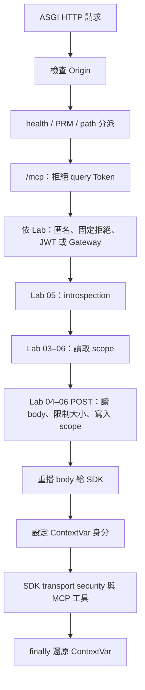
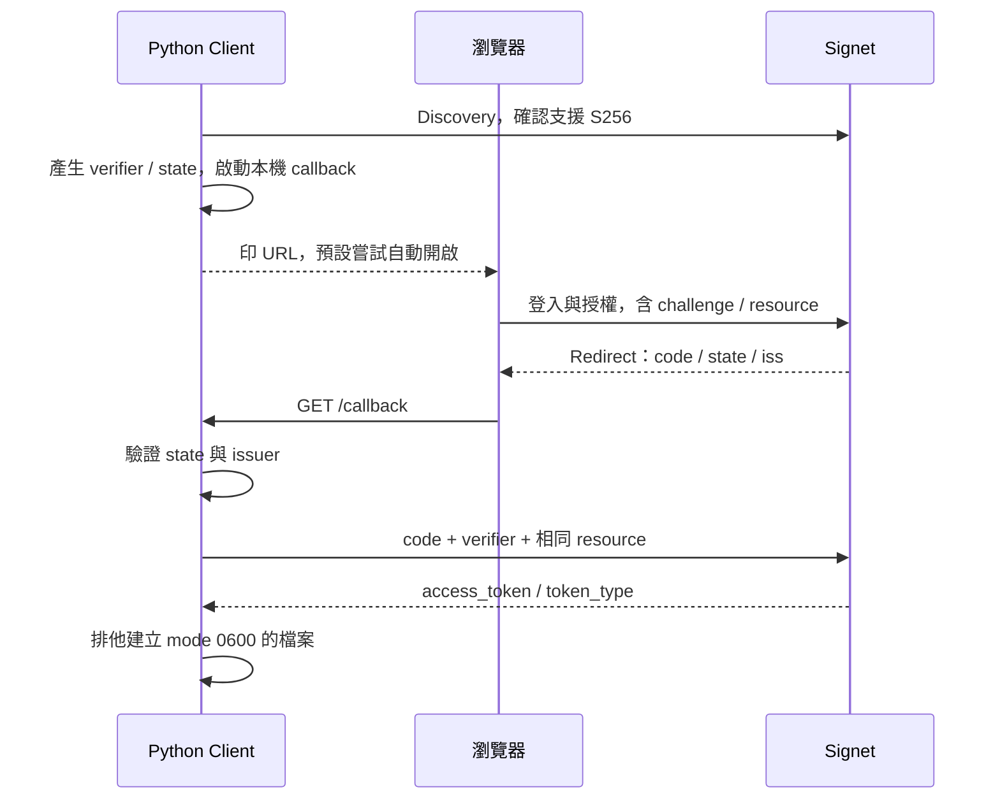

# Python 原始碼開發導讀

這份文件說明 Python 版本的程式結構、ASGI 請求流程、OAuth 授權判斷、參考 Client 與測試方式，供想深入理解或擴充程式的同仁參考。實際練習請搭配 [主課與課後選修教材](../README.md#課程路線)、[Signet Client App 設定](../docs/signet-client-app.md) 與 [故障排除](../docs/troubleshooting.md)。另一個語言版本可參考 [Go 原始碼開發導讀](../go/README.md)。

Python 版本包含 MCP Resource Server 與 public OAuth Client。Signet 是外部 Authorization Server，負責登入、授權與 Token 簽發；本目錄不實作 Signet 的帳號或同意畫面。

## 1. 目錄、依賴與閱讀順序

| 檔案 | 職責 |
| --- | --- |
| [labs/01/main.py](labs/01/main.py) 至 [labs/06/main.py](labs/06/main.py) | 六個入口，分別呼叫 `run(1)` 至 `run(6)` |
| [workshop/server.py](workshop/server.py) | 設定、Discovery、ASGI 授權 middleware、JWT、scope、introspection 與 MCP 工具 |
| [workshop/oauth.py](workshop/oauth.py) | public Client 的 `login`、`call`、`revoke`、`metadata` |
| [workshop package 說明檔](workshop/__init__.py) | `__init__.py`，只有 package 說明，沒有啟動或註冊副作用 |
| [pyproject.toml](pyproject.toml) | Python 需求、依賴、開發工具與 pytest 設定 |
| [uv.lock](uv.lock) | 鎖定依賴解析結果，供 `uv --frozen` 重現環境 |
| [Dockerfile](Dockerfile) | 建置 Lab 06 backend 映像 |
| [../tests/test_labs.py](../tests/test_labs.py) | 啟動 Go／Python 真實程序的共用黑箱測試 |

建議依序閱讀 `main.py → run → Config.from_env → create_app → Authorization.__init__ → Authorization.__call__ → 工具函式`，再讀 `oauth.py` 的登入、呼叫與撤銷流程。

六個 Lab 沒有各自複製 Server。入口只決定 Lab 編號，所有功能都在共用程式中依 `config.lab` 開關。修改 `server.py` 時，需要考慮對六關的影響。

目前 `pyproject.toml` 宣告 Python `>=3.11`，教材與 Docker 使用 Python 3.12。主要依賴為 MCP SDK `2.3.0`、`PyJWT[crypto] 2.14.0`、HTTPX `0.28.1`、Uvicorn `0.41.0`；實際完整依賴以 lockfile 為準。

- **MCP SDK**：工具註冊、schema、JSON-RPC 與 Streamable HTTP transport。
- **PyJWT + crypto**：JWKS 公鑰取得與 RS256 JWT 驗證。
- **HTTPX**：Discovery、introspection 與 Client 的 HTTP 請求。
- **Uvicorn**：執行 ASGI application。
- **Starlette**：回應物件與 threadpool helper，透過依賴樹安裝。

## 2. 整體架構與六個 Lab



Client 負責取得並攜帶 Token；Resource Server 負責判定 Token 是否能用於這個服務與操作。Signet App 的 Allowed Resources 應填**完整 URL**，例如 `http://localhost:8000/mcp`、Lab 04 B 的 `http://localhost:8001/mcp`、Lab 06 的 `http://localhost:9000/mcp`。它不是 callback URI，也不能只填 host；此值會對應登入的 `resource`、JWT 的 `aud` 與 Server 的 `MCP_RESOURCE`。

| Lab | 身分來源 | Python Server 執行的檢查 | 教學重點 |
| --- | --- | --- | --- |
| [01](../labs/01/README.md) | 固定 `anonymous` | 無 Token／scope 檢查，仍有共用 HTTP 邊界 | 沒有授權時工具可被直接呼叫 |
| [02](../labs/02/README.md) | 不建立已登入身分 | `/mcp` 固定回 401，即使攜帶有效 Token | challenge 與 Protected Resource Metadata |
| [03](../labs/03/README.md) | JWT claims | JWT 簽章、claims、讀取 scope | 可信身分；此關尚不要求寫入 scope |
| [04](../labs/04/README.md) | JWT claims | Lab 03 加上 `create_note` 寫入 scope | scope、使用者筆記與 audience 隔離 |
| [05（課後選修）](../labs/05/README.md) | JWT claims | Lab 04 加上每次請求的 introspection | 同一顆 Token 撤銷後被下一次檢查拒絕 |
| [06](../labs/06/README.md) | Gateway headers | shared secret、subject、issuer、audience、讀／寫 scope | Gateway 集中驗 Token，backend 保留工具權限檢查 |

每關可獨立啟動，不需要修改前一關的程式。切換關卡會建立新的 application 與筆記 dict。Lab 06 不會繼續執行 Lab 05 的 JWT／introspection 分支。

## 3. 啟動、設定與 application 組成

### 3.1 `run(lab)` 與 `create_app(config)`

`run` 開啟 INFO logging，從 `LISTEN_ADDR` 取得監聽位置，以最後一個冒號拆出 host／port，然後執行：

```python
uvicorn.run(create_app(Config.from_env(lab)), host=host, port=int(port), access_log=False)
```

程式關閉 Uvicorn 的逐筆 access log，保留自己定義的授權日誌。沒有在此額外設定 TLS 或自訂 shutdown hook；Server 生命週期由 Uvicorn 與 SDK 管理。

`create_app` 依序完成：

1. 檢查 Lab 必須為 1–6。
2. 建立名為 `workshop-python-labXX` 的 `MCPServer` 與區域變數 `notes = {}`。
3. 透過三個 `@mcp.tool()` decorator 註冊工具；工具 closure 共用該 application 的 notes。
4. 建立 `stateless_http=True`、`json_response=True` 的 Streamable HTTP app，設定 Host／Origin transport security。
5. 回傳 `Authorization(app, config)`，讓 SDK 的 HTTP 請求先經過授權 middleware。

`Authorization.__init__` 會驗證 resource，建立 origin／metadata URL，並依關卡初始化 issuer、JWKS Client 與 introspection 設定。Labs 03–05 的 Discovery 在啟動時執行；建立 `PyJWKClient` 本身不等於已下載 JWKS，公鑰會在驗 Token 需要時取得。

### 3.2 環境變數

| 變數 | 預設值 | 用途 |
| --- | --- | --- |
| `LISTEN_ADDR` | `127.0.0.1:8000` | 由 `run` 讀取，決定 listener；不在 `Config` dataclass 內 |
| `MCP_RESOURCE` | `http://localhost:8000/mcp` | resource 識別、JWT audience、PRM 與 transport security |
| `SIGNET_ISSUER` | 空字串 | Labs 02–05 的 issuer；Lab 06 比對 Gateway issuer |
| `READ_SCOPE` | `notes:read` | Labs 03–06 每個 `/mcp` 請求必需 |
| `WRITE_SCOPE` | `notes:write` | Labs 04–06 的 `create_note` 額外必需 |
| `INTROSPECTION_CLIENT_ID` | 空字串 | Lab 05 confidential Client ID |
| `INTROSPECTION_CLIENT_SECRET` | 空字串 | Lab 05 confidential Client secret |
| `GATEWAY_SHARED_SECRET` | 空字串 | Lab 06 至少 32 字元的 Gateway 信任憑證 |
| `ALLOW_INSECURE_ISSUER` | 未啟用 | `1` 代表允許本機 HTTP issuer／endpoint 測試替身 |

`Config.from_env` 使用 `os.getenv(name, default)`：只有變數**不存在**才用預設值，設定為空字串不會回退。這與 Go 的部分 `env` helper 行為不同。

`LISTEN_ADDR` 是實際監聽位置，`MCP_RESOURCE` 是外部識別。例如容器內監聽 `0.0.0.0:8000`，但經過 Kong 的公開 resource 是 `http://localhost:9000/mcp`。

程式與啟動腳本不會自行載入 `.env`。先依教材準備設定，再於 **repo 根目錄** 執行：

```bash
set -a
source .env
set +a
uv sync --project python --frozen
./scripts/lab.sh 03 python
```

[lab.sh](../scripts/lab.sh) 會設定 `PYTHONPATH` 指向 repo 的 `python/`，再用 `uv run --project` 執行入口。每個終端都需自行載入環境；直接執行 Lab 檔案時也需確保 `workshop` package 在 import path 上。

## 4. URL 驗證、Discovery 與 PRM

### 4.1 `trusted_url` 與 `validate_resource`

`trusted_url` 使用 `urlsplit`，要求有 netloc，拒絕非空 username／password 與 fragment。正常情況只接受 HTTPS；開啟測試開關才接受 hostname 為 `localhost`、`127.0.0.1`、`::1` 的 HTTP。

`validate_resource` 要求有 netloc、path 恰好為 `/mcp`，不能有非空 query、fragment 或 username。允許 HTTPS，以及 `localhost`／`127.0.0.1` 的 HTTP；resource 的本機 HTTP 例外不包含 `::1`。

這是現有程式的判斷條件，不是通用 URL 安全驗證器。例如 resource 檢查沒有像 `trusted_url` 一樣單獨檢查 password，也沒有拒絕所有形式的空 userinfo。Discovery 亦不要求各 endpoint 與 issuer 同源，因此 issuer 設定本身必須可信。

### 4.2 `discover(issuer)`

以 `https://auth.example/team` 為例，候選順序是：

1. `https://auth.example/.well-known/oauth-authorization-server/team`
2. `https://auth.example/.well-known/openid-configuration/team`
3. `https://auth.example/team/.well-known/openid-configuration`

沒有 path 時只使用前兩項。Discovery 使用 5 秒 HTTPX Client、不跟隨 redirect。HTTP 或 JSON 解析失敗會嘗試下一個候選；若 metadata 中的 issuer 與設定不完全相等，則立即失敗。尾端斜線也會影響相等判斷。

metadata 中出現的 `jwks_uri`、authorization、token、revocation、introspection endpoint 會經 `trusted_url`，各呼叫端再存取所需欄位。程式未提供完整 metadata schema 驗證，也沒有像 Go `readJSON` 一樣設定上游 JSON 的 1 MiB 讀取上限。

### 4.3 Protected Resource Metadata

Labs 02–05 在 middleware 直接處理以下 GET 路徑：

- `/.well-known/oauth-protected-resource/mcp`
- `/.well-known/oauth-protected-resource`

兩者回傳相同內容：`resource`、`authorization_servers`、`scopes_supported`、`bearer_methods_supported: ["header"]`。目前只宣告 read scope；缺少寫入權限時，403 challenge 會額外列出 write scope。其他 method 回 405。

`denied()` 對 401／403 加上 `WWW-Authenticate: Bearer ...`，其中 `resource_metadata` 指向帶 `/mcp` 的 PRM 路徑，讓 Client 能沿著 challenge 找到 issuer。Lab 01 不提供 PRM；Lab 06 的公開 PRM 由 Gateway 負責。

## 5. ASGI middleware 如何處理請求

### 5.1 `scope`、`receive`、`send` 分別是什麼？

`Authorization.__call__(scope, receive, send)` 是 ASGI application 介面。這裡的 `scope` 是連線／請求資訊 dict，**不是 OAuth 權限 scope**：

- `scope`：包含請求 type、path、method、headers 與 query string。
- `receive()`：非同步取得 body chunk 或 disconnect 等事件。
- `send()`：將 HTTP response 事件交給 Server。

非 HTTP 事件直接轉交內層 app，讓 SDK 的 lifespan 等處理繼續運作。HTTP headers 的名稱會轉成小寫，再依序執行下列流程。



圖中的授權檢查依 Lab 條件執行；health 與 PRM 在路由階段直接回應。

### 5.2 HTTP 邊界與執行順序

Origin header 若不存在，程式採用 resource origin 作為預設而放行；若存在，值必須完全等於 resource 的 `scheme://netloc`。明確傳入空 Origin 會被拒絕，與 Go 接受空值的行為不同。

Origin 通過後，`/healthz` 直接回 `ok`，PRM 依上節處理，不是 `/mcp` 的其他路徑回 404。`/mcp` 的 query 若包含 `access_token`，包括空值，回 400。

內層 SDK 另有 `TransportSecuritySettings`：allowed hosts 包含 resource 的 netloc、`localhost:*`、`127.0.0.1:*`；allowed origin 為 resource origin。黑箱測試確認不被允許的 Host 在通過自訂授權後仍會被 SDK 以 421 拒絕。這一層只會處理到達 SDK 的請求，不能把它視為對 middleware 直接回應的 health／PRM 路由也有效。

### 5.3 JWT：`Authorization.verify(raw)`

Labs 03–05 要求 Authorization 能拆成兩個欄位，且第一個為 Bearer（不分大小寫）。`verify` 先以 `PyJWKClient.get_signing_key_from_jwt` 取得公鑰，再呼叫 `jwt.decode`：

| 欄位／項目 | 檢查 |
| --- | --- |
| 演算法／簽章 | 只允許 RS256，使用 JWKS 公鑰驗證 |
| `iss` | 必須存在，且等於設定的 issuer |
| `aud` | 必須存在，且包含 resource；保留字串或陣列形狀 |
| `exp` | 必須存在且未過期 |
| `sub` | 必須存在，且為非空字串 |
| `iat`、`nbf` | 未列為必填；存在時由 PyJWT 的驗證規則處理 |
| `type` | 必須為 `access` |
| `scope` | 必須為字串；是否含必要權限由下一階段判斷 |
| `jti` | 非必填，映射成 `token_id`，缺少時為空字串 |

`PyJWKClient` 的 JWK Set cache lifespan 設為 300 秒，網路 timeout 為 5 秒。它快取的是公鑰資料，不是每顆 Token 的授權或撤銷結果。

因 JWKS 取得與驗證是同步工作，middleware 用 `await run_in_threadpool(self.verify, raw)` 執行，避免直接阻塞 ASGI event loop。`PyJWKClientConnectionError` 轉為 503；其他已列入 catch 的 JWT／claims 錯誤轉為 401。

Labs 03–05 的身分來自 JWT，不採用外部提供的 `X-MCP-Subject`。驗證成功會回傳包含 subject、scope、audience、token ID 的 dict。

### 5.4 Introspection：`Authorization.active(raw)`

Lab 05 在 JWT 通過後、scope 檢查之前，用 `httpx.AsyncClient(timeout=5, follow_redirects=False)` POST Token 與 `token_type_hint=access_token`。confidential Client ID／secret 經 `quote_plus` 後作為 HTTP Basic 憑證。

introspection 只讀取 `active`，要求它是 Python `bool`，而不是任意 truthy 值。因此缺少、null、字串或數字都不會當作有效布林值。已處理的 HTTP／JSON／值錯誤回 503；`active: false` 回 401；`true` 才繼續。

subject、scope 等身分仍來自已驗證的 JWT，所以回應只有 `{"active": true}` 也足夠。此處每次建立 AsyncClient 並發出請求，沒有成功快取或跨請求共用的連線池。

此設計讓下一次請求能看到撤銷結果，但同時增加網路往返與上游可用性依賴。Labs 03–04 僅做本地 JWT 檢查，不會即時知道 Token 已被撤銷。

### 5.5 Scope、body 上限與 `replay()`

Labs 03–06 以 `caller["scope"].split()` 做完整權限值比對，每個 `/mcp` 請求都要求 read scope。只有 write scope 不足以通過。

Labs 04–06 的 POST 會先讀取 ASGI body chunks：

1. 收到 `http.disconnect` 就停止處理。
2. 累計 body bytes 超過 1 MiB，回 413。
3. 合併 body 並解析 JSON；若為 `tools/call` 且 `params.name` 是 `create_note`，額外要求 write scope。
4. 不足時回 403，challenge 列出讀與寫 scope。無法解析的 JSON 不在此判斷工具權限，交給 SDK 處理。
5. 定義新的 `replay()` 作為 `receive`：第一次回傳完整 body，之後才委派原始 receive。

ASGI 的 body stream 不能假設可重讀。沒有 replay，SDK 就可能拿不到 middleware 已消耗的內容。工具內還會再次檢查 write scope，因此不是只靠 HTTP body 的名稱辨認維持權限。

### 5.6 `ContextVar` 的身分生命週期

模組層級的 `identity = contextvars.ContextVar("identity", default=None)` 保存目前執行 context 的身分。middleware 先 `marker = identity.set(caller)`，再呼叫內層 app，最後在 `finally` 執行 `identity.reset(marker)`，即使發生例外也還原。

這個 marker 是 ContextVar 還原用的標記，不是 OAuth Token。它避免把 caller 放在一般全域變數而造成不同請求讀到彼此身分；工具用 `identity.get()` 取得目前 caller。直接繞過 middleware 呼叫工具時，預設可能是 `None`，因此擴充路由仍需維持授權鏈。

目前安裝的 MCP SDK 會把同步工具送到 AnyIO worker thread 執行，其 context 傳遞讓工具能讀取上述身分。ContextVar 解決的是身分 context 隔離，並不替筆記 dict 加鎖。

## 6. MCP 工具、資料與並行限制

| 工具 | 輸入 | 處理與回傳 |
| --- | --- | --- |
| `whoami() -> dict` | 空物件 | 回 `identity.get()`，包含已驗證身分，不回 raw Token |
| `list_notes() -> dict` | 空物件 | 用 subject 查詢，回 `{"notes": [...]}` |
| `create_note(text: str) -> dict` | `{"text": "內容"}` | 檢查 scope、長度與筆記數量，追加後回該 subject 全部筆記 |

SDK 根據函式名稱、docstring 與 type hints 建立工具資訊並處理呼叫。Python 的回傳標註是一般 `dict`，沒有像 Go `whoami` 一樣另寫具體的 audience output schema；實際資料仍保留 JWT audience 的字串／陣列形狀。

筆記保存在 `create_app` closure 的 dict，以 subject 作為 key，value 為 list。`list(...)` 產生回傳副本，沒有筆記時得到空陣列。Lab 01 的所有使用者都是 `anonymous`，因此共用匿名筆記。

`create_note` 用 Python `len(text)` 要求 1–500 個 Unicode code points，不是 UTF-8 bytes，也不是畫面上的字形數；每個 subject 最多 100 筆。程序重啟就清空，沒有資料庫、更新、刪除或跨 worker 同步。

**現有實作沒有鎖。** 同步工具可在 worker threads 並行執行，因此「檢查筆記數量，再 append」不是受保護的原子操作，不能宣稱併發時一定守住 100 筆上限。若擴充為多人服務，需加入適合執行模型的同步機制或資料庫交易；也不能只靠增加 Uvicorn workers 共用這份記憶體資料。

`stateless_http=True` 指 transport 的 session 模式，不代表工具沒有可變狀態；notes 仍然是 application 內的業務狀態。

## 7. OAuth 參考 Client

[workshop/oauth.py](workshop/oauth.py) 以 `argparse` 解析命令，再分派 `login`、`call`、`revoke` 或 `metadata`。模組入口使用 `raise SystemExit(main())`，將回傳值變成程序 exit code。

它使用預先註冊的 public Client，不需要登入用的 Client secret，也不實作 refresh Token 更新、自動註冊或完整的通用 MCP Client session 管理。

### 7.1 執行方式與參數

建議在 **repo 根目錄** 用 [oauth.sh](../scripts/oauth.sh)，它設定 `PYTHONPATH`，再執行 `uv run --project python python -m workshop.oauth`。wrapper 會切到 repo 根目錄，讓相對 Token 路徑保持一致。

| 參數 | 預設值／用途 |
| --- | --- |
| positional `command` | 必填：`login`、`call`、`revoke`、`metadata` |
| `--issuer` | `SIGNET_ISSUER` |
| `--resource` | `MCP_RESOURCE`，未設定時為 `http://localhost:8000/mcp` |
| `--client-id` | `OAUTH_CLIENT_ID` |
| `--scopes` | 固定預設 `notes:read`，不自動讀取 Server 的 `READ_SCOPE` |
| `--callback-port` | `8765` |
| `--no-browser` | 不自動開瀏覽器，仍印出登入 URL |
| `--token-file` | `.tokens/access.json`，解析為 `pathlib.Path` |
| `--tool` | 預設 `whoami`，只接受三個既有工具名稱 |
| `--text` | `Hello workshop`，作為 `create_note` 的文字 |
| `--allow-cross-resource` | 預設關閉，僅供本機 Lab 04 audience 反例 |

CLI 的 token exchange、call、revoke 使用 10 秒 HTTPX Client 且不跟隨 redirect；Discovery 仍使用共用的 5 秒設定。

### 7.2 `login(args)`：PKCE 登入



執行細節：

1. 驗證 resource，Discovery 後確認 metadata 宣告 `S256`，檢查 Client ID 與 Token 檔不得已存在。
2. `secrets.token_urlsafe(48)` 產生 verifier；SHA-256 後以無 padding 的 URL-safe Base64 產生 challenge。state 另外使用 `secrets.token_urlsafe(32)`。
3. 以標準函式庫 `HTTPServer` 綁定 `127.0.0.1`。預設 callback 是 `http://127.0.0.1:8765/callback`；port `0` 可讓系統挑選，供測試使用，實際 App 仍須接受該 redirect URI。
4. 組合 authorization URL，包含 code response type、Client ID、redirect URI、scope、state、challenge、S256 與 resource。印出後，除非傳 `--no-browser`，否則嘗試 `webbrowser.open`。
5. callback 只實作 GET，檢查 path 與 state，後者使用 `secrets.compare_digest`。關閉預設 callback access log，避免記錄 code 與 query string。
6. 以 `handle_request()` 迴圈等候回呼，設定 1 秒 server timeout 與 180 秒 deadline；此 deadline 是迴圈條件，不是對每條 callback 連線的完整硬性 timeout。
7. 回呼有 error、缺少 code 或未收到結果時失敗。若 metadata 宣告支援 authorization response issuer，要求 `iss`；收到時必須與設定完全相等。
8. POST code、verifier、Client ID、相同 redirect URI 與 resource 換 Token，要求 HTTP 200。public Client 不帶 Client secret。
9. 檢查 access Token 為字串、token type 為 Bearer，再交給 `save_token`。此版本未額外拒絕空的 access Token 字串，也未在登入階段自行驗 JWT。

callback 網頁顯示收到回呼，不代表後續 exchange 已成功，應以終端結果為準。Token response 亦不是完整 schema 驗證，不要將教學 Client 視為能處理所有異常格式的通用函式庫。

### 7.3 `save_token(path, data)`

新建 Token 父目錄指定 mode 0700，檔案使用 `os.open(..., O_WRONLY | O_CREAT | O_EXCL, 0o600)`，避免覆寫已存在的檔案或跟隨該檔名的 symlink。既有父目錄權限不會自動修正，也不代表所有中間目錄都會被重新設權限。

JSON 只存 `access_token`、`issuer`、`resource`，不存 refresh Token。這是權限受限的本機明文檔，不是加密保管庫。成功訊息只顯示路徑，不印 Token 值。

### 7.4 `call(args)`：resource 綁定與 JSON-RPC

先驗證目的 URL，再處理 Token 檔。檔案不存在時匿名呼叫，供 Lab 01 使用；存在時讀取 JSON，要求所記錄的 resource 與目標完全相等，再加入 Authorization header。

`--allow-cross-resource` 只略過 Client 端的 resource 相等檢查，目標 hostname 仍限 `localhost` 或 `127.0.0.1`，且仍經 URL 驗證。它不改寫 Token，也不放寬 Server 的 audience 判斷。

Client 使用常數 `PROTOCOL_VERSION = "2026-07-28"`，目前直接送 `tools/call`，不送 initialize。請求包括：

- headers：`Accept`、`MCP-Protocol-Version`、`Mcp-Method`、`Mcp-Name`，有檔案時加 Bearer Token；HTTPX 的 `json=` 設定 JSON content type。
- JSON-RPC：`jsonrpc: "2.0"`、`id: 1`、`method: "tools/call"`。
- `params`：name、arguments、`_meta`；metadata 包含 protocolVersion、clientInfo、clientCapabilities。

只有 `create_note` 組成 `{"text": args.text}`，其餘 arguments 為空物件。Client 印出 HTTP status、challenge 與 response text，僅在 HTTP 200、沒有 `error` 欄位、`result` 是 dict 且沒有 truthy `isError` 時回傳成功。

因此 HTTP 200 仍可能 exit code 1。此 Client 沒有完整 SSE 消費邏輯，也沒有自訂的 response body 大小上限。

### 7.5 `revoke(args)` 與 `metadata`

`revoke` 讀取 Token 檔並比對 issuer，再透過 Discovery 找到 revocation endpoint，POST Token 與 access token hint。它不傳 Client secret，以 `raise_for_status()` 判斷 HTTP 成功，不解析 response body。

成功後保留檔案，方便用**同一顆 Token** 重試 Lab 05。刪除檔案不是遠端撤銷，遠端撤銷也不代表只做離線 JWT 驗證的服務會立刻拒絕。

`metadata` 直接印出格式化的 Discovery JSON。`main` 將已列出的 `ValueError`、`KeyError`、`OSError`、`httpx.HTTPError` 轉成 `Error: ...` 與 exit code 1；不是所有可能的程式例外都被包裝。

### 7.6 用指令對照程式

以下在 repo 根目錄執行，先完成 App 設定並載入 `.env`，另一個終端啟動 Lab 04。Token 檔名必須尚未存在：

```bash
./scripts/oauth.sh python metadata
./scripts/oauth.sh python login --resource http://localhost:8000/mcp \
  --scopes 'notes:read notes:write' --token-file .tokens/python-guide.json
./scripts/oauth.sh python call --resource http://localhost:8000/mcp \
  --token-file .tokens/python-guide.json --tool whoami
./scripts/oauth.sh python call --resource http://localhost:8000/mcp \
  --token-file .tokens/python-guide.json --tool create_note --text '閱讀 Python 原始碼'
./scripts/oauth.sh python call --resource http://localhost:8000/mcp \
  --token-file .tokens/python-guide.json --tool list_notes
```

觀察撤銷時，先備妥 introspection 憑證並改啟動 Lab 05，確認同一顆 Token 仍可呼叫，再執行：

```bash
./scripts/oauth.sh python revoke --token-file .tokens/python-guide.json
./scripts/oauth.sh python call --resource http://localhost:8000/mcp \
  --token-file .tokens/python-guide.json --tool whoami
```

最後一次預期 HTTP 401 與非零 exit code。重啟 Server 會清空筆記，但不會刪除本機 Token。

## 8. Lab 06：容器與 Gateway 邊界

[Dockerfile](Dockerfile) 以 `python:3.12-slim` 為基底，複製固定版本 uv，以 `uv sync --frozen --no-dev` 安裝執行依賴，再複製 Python 程式。設定 `PYTHONPATH=/app`、使用 UID/GID `65532:65532`，固定執行 `labs/06/main.py`；不會靠 `LAB` 環境變數切換關卡。

[Compose](../labs/06/compose.yml) 只把 Kong 公開到 `127.0.0.1:9000`，backend 使用 internal network 且沒有發布 host port。Python backend 的 listener 是 `0.0.0.0:8000`，resource 則是 `http://localhost:9000/mcp`。

[設定產生器](../scripts/configure_gateway.py) 配置 issuer、read scope、Gateway resource 與 shared secret，並保留 Host 給 backend 的 SDK 檢查。Kong request-transformer 會移除再加入 `X-Workshop-Gateway`。外部 plugin 的 Token 驗證原始碼不在此目錄，完整啟動方式見 [Lab 06](../labs/06/README.md)。

Python backend 的 Lab 06 分支：

1. 使用 `hmac.compare_digest` 比對 `X-Workshop-Gateway` 與 shared secret。
2. 從 `X-MCP-Subject`、`X-MCP-Scope`、`X-MCP-Audience`、`X-MCP-Token-Id` 建立 caller。
3. 要求 subject 非空、`X-MCP-Issuer` 等於設定、audience 等於 resource。
4. 繼續執行讀／寫 scope、body 限制與工具操作。

backend 不再驗證 Bearer Token，也不執行 introspection。私有網路、secret 保密與 Gateway 產生可信身分 headers 是信任模型的一部分；若持有 secret 並能直接存取 backend，就能構造它接受的身分 headers。

## 9. 日誌與錯誤排查

成功授權日誌包含 Lab、subject、token ID、HTTP method；拒絕日誌包含 Lab、HTTP status、原因，不印 raw Token。「authorized request」表示通過自訂 middleware，不保證 SDK Host 檢查或工具執行成功，也不是完整業務稽核。

| 現象 | 排查位置／含意 |
| --- | --- |
| 啟動例外 | `Config.from_env`、`create_app`、`Authorization.__init__`；檢查 URL、Discovery、Lab 05 憑證與 Lab 06 secret |
| 400 `token_in_query_forbidden` | `/mcp` query 出現 `access_token` |
| 401 `invalid_token` | Lab 02 固定拒絕；或 Bearer／JWT／撤銷狀態不符 |
| 401 `untrusted_gateway` | shared secret 未通過 |
| 401 `invalid_gateway_identity` | subject、issuer 或 audience 不符 |
| 403 `untrusted_origin` | 自訂 middleware 的 Origin 不符 |
| 403 `insufficient_scope` | 缺少 read／write scope，查看 challenge |
| 413 `request_too_large` | Labs 04–06 POST body 超過 1 MiB |
| 421 | SDK transport security 拒絕 Host |
| 503 `temporarily_unavailable` | JWKS 連線錯誤，或 Lab 05 已捕捉的 introspection 錯誤 |
| HTTP 200 但 CLI 失敗 | JSON-RPC error、工具 `isError` 或不符合 Client 預期的 result |
| CLI `token resource differs` | 尚未送出請求，檔案 resource 與目標不符 |
| CLI `token file already exists` | 登入防覆寫，改用新檔名 |

`denied` 統一設定 JSON 與 `Cache-Control: no-store`，401／403 加 Bearer challenge。Python 的 `untrusted_origin` 也走這個 helper；health、404、405 與 SDK 回應不一定具有相同 headers。

## 10. 測試與驗證方式

Python 的主要驗證在 [tests/test_labs.py](../tests/test_labs.py)，並非 `python/` 內另有一套單元測試。fixture 使用本機 RSA issuer、JWKS、授權碼、Token 與撤銷狀態，啟動真實 Server 程序後以 HTTP 呼叫；同一組案例對 Go／Python 參數化執行。

| 測試組 | 驗證內容 |
| --- | --- |
| Lab 01 | discovery、工具清單與匿名身分 |
| Lab 02 | 401 challenge、PRM、有 Token 仍固定拒絕 |
| Lab 03 | 無 Token、過期／缺少 exp、錯誤 issuer／audience／type／subject、偽造簽章、audience 字串／陣列 |
| HTTP 邊界 | query Token、惡意 Origin、偽造 subject header |
| Lab 04 | write scope、Alice／Bob 筆記隔離、A／B audience 隔離 |
| Lab 05 | active、撤銷後 401、上游不可用時 503 |
| Lab 06 | 缺少 shared secret、可信身分、寫入權限、錯誤 audience |
| Client lifecycle | PKCE、錯誤 state、resource 綁定、檔案權限、call／revoke／重試 |
| Client errors | 不安全目的地、非本機 cross-resource、HTTP 200 的 JSON-RPC error |
| Gateway 與 Python Host | 設定檔權限、preserve host、有效 Host 與惡意 Host 的 421 |

在 **repo 根目錄** 執行完整檢查：

```bash
./scripts/check.sh
```

此腳本先檢查 Go，再執行 Python 依賴同步、Ruff lint／format 與 pytest。Python 相關命令也可以單獨執行：

```bash
uv sync --project python --frozen
uv run --project python --frozen ruff check python tests scripts
uv run --project python --frozen ruff format --check python tests scripts
uv run --project python --frozen pytest -q tests/test_labs.py
```

共用測試的 session fixture 會建置 Go binaries，因此即使主要閱讀 Python，執行完整黑箱套件仍需安裝 Go。測試不依賴真實 Signet 帳密，也不代表已驗證真實瀏覽器、AI CLI 或 Kong plugin；Lab 06 boundary 測試是直接向 backend 傳 headers。

現有測試沒有完整涵蓋所有畸形 metadata、並行筆記容量或所有異常 callback。新增功能時應針對實際變動補上成功與拒絕案例，不能只靠既有測試全綠推論所有邊界都已證明。

## 11. 與 Go 版本對照

| 面向 | Python | Go |
| --- | --- | --- |
| HTTP 執行模型 | Uvicorn／ASGI，receive／send 事件 | `net/http` handler |
| 身分傳遞 | `ContextVar`，finally reset | request context 與私有 key |
| JWT 工作 | PyJWT，threadpool 執行同步驗證 | golang-jwt 與 keyfunc |
| POST body 重讀 | ASGI `replay()` | 重新設定 `r.Body` |
| 筆記並行 | 現有 dict／list 沒有鎖 | `sync.Mutex` 保護 |
| Host 檢查 | SDK allowed hosts，有 421 測試 | 共用程式主要檢查 Origin，沒有相同的 Host 設定 |
| JWKS 連線失敗 | 明確轉為 503 | `verify` 失敗統一走 401 |
| 登入瀏覽器 | 預設自動嘗試開啟，可 `--no-browser` | 印 URL，由使用者手動開啟 |
| CLI 工具名稱 | argparse 限三個已知值 | 可傳任意名稱，再由 Server 判斷 |
| whoami schema | 一般 `dict` type hint | 明確定義 audience 的兩種型別 |
| 空環境變數 | 保留空字串 | 部分 helper 回退預設值 |

兩者的教學目標一致，但不是每個錯誤分支、執行細節與防護都完全相同。跨語言調整時，應用共用測試確認預期一致的行為，再個別檢查語言特有部分。

## 12. 擴充功能從哪裡開始

| 目的 | 主要位置 | 需要一起考慮 |
| --- | --- | --- |
| 新增 MCP 工具 | `create_app` 的 `@mcp.tool()` | 輸入／輸出型別、schema、權限與工具失敗回應 |
| 新增寫入權限 | `Authorization.__call__` 與工具內 | HTTP challenge 與業務操作雙層檢查，避免只檢查工具名稱 |
| 改 scope | `Config`、PRM、Client 參數 | Signet App 設定、登入 scope、測試與文件一致 |
| 新增 HTTP 路由 | `Authorization.__call__` | 現在未知 path 直接 404；要明確決定新路由是否經身分與 SDK Host 檢查 |
| 改 JWT／Discovery | `verify`、`discover`、`trusted_url` | audience、issuer、用途、效期與失敗分支的回歸案例 |
| 加資料庫／多人並行 | notes closure 與筆記工具 | 可信 subject 的查詢隔離、交易／鎖、多 worker 資料一致性 |
| 改 Client | `oauth.py` | callback、state、resource 綁定、錯誤 exit code 與 CLI 黑箱測試 |
| 改 Gateway 信任方式 | Lab 06 分支、Compose、設定產生器 | Host 傳遞、私有 backend、secret 與可信身分 headers |

目前程式保留教學所需功能，沒有永久儲存、總使用者容量限制、速率限制、完整稽核或 refresh 流程。深入開發時，先確認要修改的是 transport、身分驗證、權限判斷還是業務資料，再在對應層加入功能與回歸驗證。
